# 🧠 Zincirlerden Otonom Şirketlere: İnsan Dilinde LangGraph ve Ajan Mimarisi

**Alt Başlık:** *Kod Hamallığı Yapmadan Yapay Zeka Ajanlarını, LangGraph Ekosistemini, LangSmith Gözlemlenebilirliğini ve Çoklu Ajan Şirketlerini Uçtan Uca Anlama Rehberi*

---

## 📑 İçindekiler

- **Önsöz: Bir "Vibe Coder"ın Mimari Manifestosu**
- **KISIM I: ZİHİNSEL DEVRİM — ZİNCİRLERDEN DÖNGÜSEL BEYİNLERE**
  - **Bölüm 1:** Neden LangGraph? (Çıplak LLM, DAG, LCEL ve Döngüsel Ajan Devrimi)
  - **Bölüm 2:** LangGraph'ın Anatomisi — State, Node ve Edge Üçlüsü
- **KISIM II: AJANLARA EL, KOL VE MUHAKEME KAZANDIRMAK**
  - **Bölüm 3:** Araç Çağırma (Tool Calling), ReAct Felsefesi ve Yapılandırılmış Kararlar
- **KISIM III: ZAMAN, HAFIZA VE İNSAN KONTROLÜ (İLERİ RUNTIME)**
  - **Bölüm 4:** Kalıcılık (Persistence), Checkpointer Mimarisi ve Kısa/Uzun Süreli Hafıza
  - **Bölüm 5:** Human-in-the-Loop (İnsan Onayı), `Command` Mekanizması ve Zamanda Yolculuk (Time-Travel)
- **KISIM IV: BİLGİ SİSTEMLERİ, EKİP MİMARİLERİ VE OTONOM ŞİRKET**
  - **Bölüm 6:** Kopyala-Yapıştırın Sonu — Modern RAG, Agentic RAG, MCP ve Dinamik Beceriler (Skills)
  - **Bölüm 7:** Tek Beyinden Orkestraya — 6 Çoklu Ajan Deseni, Subgraph'lar ve `Send` API
  - **Bölüm 8:** Vaka Analizi — Otonom Yazılım Evi & Uygulama Stüdyosu (06_yonetici_sirket) Röntgeni
- **KISIM V: GÖZLEMLENEBİLİRLİK, ÜRETİM MÜHENDİSLİĞİ VE TÜM EKOSİSTEM**
  - **Bölüm 9:** Kör Uçuşun Sonu — LangSmith, Run Tree, Maliyet/Gecikme ve Kalite Sınavları (Evals)
  - **Bölüm 10:** Saha Dersleri — Kotalar, Anahtar Rotasyonu, 20x Hızlandırma ve Kurumsal Güvenlik
  - **Bölüm 11:** Ekosistem Haritası — LangGraph Studio, LangGraph Platform, Generative UI ve Yardımcı Araçlar
  - **Bölüm 12:** Mezuniyet Yol Haritası — Kişisel Danışman Ajandan Gerçek Şirkete Geçiş Planı
- **Ekler:** Hızlı Karar Ağacı & Kapsamlı LangGraph Terimler Sözlüğü

---

## Önsöz: Bir "Vibe Coder"ın Mimari Manifestosu

Yazılım dünyası yüz yılda bir gerçekleşen bir kırılma yaşıyor. Eskiden iyi bir mühendis olmak, yüzlerce satırlık sözdizimini (syntax) ezbere yazabilmek, noktalı virgülleri unutmamak ve karmaşık kütüphane parametrelerini akılda tutmak demekti. Bugün ise **kodu yazmak ucuzladı; neyin, neden ve hangi mimariyle inşa edileceğine karar vermek ise her şey oldu.**

Bu kitap klasik bir programlama kitabı değildir. Sayfalar dolusu sıkıcı kod blokları arasında kaybolmayacaksınız. Tam tersine bu kitap, [LangGraph_Course](file:///c:/Users/aytgn/Desktop/LangGraph_Course/README.md) çalışma alanında sıfırdan başlayarak adım adım inşa ettiğimiz **5 canlı projenin**, kurduğumuz **Vibe Coder Web Laboratuvarının**, çözdüğümüz gerçek krizlerin (kota duvarları, 30 saniyelik gecikmeler, veritabanı kilitleri, güvenlik frenleri) ve yol boyunca sorduğumuz onca kritik *"Peki ama bunu arka planda nasıl anlıyor?"* sorusunun damıtılmış halidir.

> [!IMPORTANT]
> **Bu Kitabın Altın Kuralı:** Bir yapay zeka mimarının görevi satır satır tuğla örmek değil, binanın statiğini, elektrik tesisatını, güvenlik kapılarını ve odalar arası geçişini tasarlamaktır. Bu kitabı bitirdiğinizde tek bir satır kodu ezberlemiş olmayacaksınız; ama **LangGraph ve etrafındaki tüm araç ekosisteminin nasıl çalıştığını bir başmimar berraklığında bileceksiniz.**

Yolculuğumuz boyunca kendi elimizle kurduğumuz şu istasyonları sürekli canlı laboratuvarımız olarak kullanacağız:
1. **Temel Eğitim ([01_merhaba_langgraph.py](file:///c:/Users/aytgn/Desktop/LangGraph_Course/01_temel_egitim/01_merhaba_langgraph.py) & [02_tool_react_ajani.py](file:///c:/Users/aytgn/Desktop/LangGraph_Course/01_temel_egitim/02_tool_react_ajani.py)):** İlk durum grafımız, Eğitmen-Eleştirmen ikilisi ve çok adımlı finansal ReAct ajanımız.
2. **İleri Runtime ([01_hafizali_ajan.py](file:///c:/Users/aytgn/Desktop/LangGraph_Course/02_derinlesme_runtime/01_hafizali_ajan.py)):** SQLite çelik kasası, CEO Ahmet ile Muhasebeci Mehmet'in izole hafızaları ve 150.000 TL'lik havalede devreye giren insan onayı freni.
3. **Ekip Mimarisi ([01_supervisor_ekibi.py](file:///c:/Users/aytgn/Desktop/LangGraph_Course/03_ekip_mimarisi/01_supervisor_ekibi.py)):** Proje yöneticisi (Supervisor) liderliğinde çalışan Araştırmacı ve Geliştirici uzman ekibi.
4. **Gözlemlenebilirlik ([01_langsmith_izleme.py](file:///c:/Users/aytgn/Desktop/LangGraph_Course/04_gozlemlenebilirlik/01_langsmith_izleme.py) & [langsmith_atolyesi.ipynb](file:///c:/Users/aytgn/Desktop/LangGraph_Course/04_gozlemlenebilirlik/langsmith_atolyesi.ipynb)):** Canlı telemetri, gecikme/maliyet hesabı, LangSmith ağaçları ve kişisel deney günlüğü atölyemiz.
5. **Otonom Şirket Temeli ([05_otonom_ajan_sirketi/](file:///c:/Users/aytgn/Desktop/LangGraph_Course/05_otonom_ajan_sirketi/sirket_motoru.py)):** Hibrit CEO orkestrasyonu, pazar araştırması ve bütçe onay bariyeri prototipimiz.
6. **Büyük Final — Otonom Yazılım Evi & Uygulama Stüdyosu ([06_yonetici_sirket/](file:///c:/Users/aytgn/Desktop/LangGraph_Course/06_yonetici_sirket/yonetici_masasi.py)):** Büyük teknoloji şirketlerinin Clean Architecture standartlarında; CPO + CTO ürün keşif konseyi, döngüsel LangGraph yazılım fabrikası, deterministik Python AST denetimi, 3 yönlü Kurucu Karar Kapısı (Onayla, Revize Et, Reddet), gerçek SQLite CRUD portföyü ve port çakışmasız tek tıkla fiziksel çalıştırma paketi.

Kemerlerinizi bağlayın. Önce zihnimizdeki "sohbet botu" algısını yıkıp yerine gerçek "otonom sistem" mimarisini kurarak başlıyoruz.

---

# KISIM I: ZİHİNSEL DEVRİM — ZİNCİRLERDEN DÖNGÜSEL BEYİNLERE

## Bölüm 1: Neden LangGraph? (Çıplak LLM, DAG, LCEL ve Döngüsel Ajan Devrimi)

### 1.1 Kavanozdaki Dahi Beyin: Çıplak LLM Nedir ve Neyi Yapamaz?

Gemini, GPT veya Claude gibi Büyük Dil Modellerini (LLM) gözünüzde canlandırmak için şu metaforu kullanın: **Cam bir kavanozun içinde yaşayan, dünyadaki tüm kütüphaneleri okumuş süper zeki bir profesör.**

Bu profesörle camın arkasından konuşabilirsiniz. Ona *"Bana Roma İmparatorluğu'nu anlat"* derseniz muazzam bir kompozisyon yazar. Ama ona şu üç cümleden birini söylerseniz çaresiz kalır:
1. *"Şu an Apple hissesi kaç dolar?"* — Bilmez, çünkü kavanozun dışındaki canlı internete eli uzanmaz.
2. *"Tedarikçiye 150.000 TL havale yap."* — Yapamaz, çünkü banka sisteminin butonlarına basacak elleri ve kolları yoktur.
3. *"Dün sana söylediğim gizli bütçemiz ne kadardı?"* — Hatırlamaz! Çünkü her soru-cevaptan sonra kavanozdaki profesörün hafızası tamamen silinir (Stateless / Durumsuz çalışır). Sohbet uygulamalarında sizi hatırlıyormuş gibi görünmesinin tek sebebi, uygulamanın her yeni mesajınızda **eski konuşmanın tamamını baştan sona profesöre gizlice tekrar okutmasıdır.**

İşte bir **Ajan (Agent)**, bu kavanozdaki dahi beyne **göz (veri okuma), el-kol (araç çalıştırma), not defteri (hafıza) ve iç ses (kendi hatasını görüp düzeltme döngüsü)** takılmış halidir.

---

### 1.2 Deterministik Yazılım vs Olasılıksal (Probabilistic) Sistemler

Klasik yazılımda her şey kesin kurallara bağlıdır (`Deterministik`). Bir hesap makinesinde `2 + 2` tuşuna milyon kere bassanız milyonunda da `4` çıkar. Akış şeması mühendis tarafından önceden çivilenmiştir: *"Müşteri şu butona basarsa A fonksiyonuna git, şuna basarsa B fonksiyonuna git."*

Yapay zeka ajanları ise **olasılıksal (`Probabilistic`)** karar verir. Kullanıcı *"Finans servisimiz sağlıklı mı, bir de 6 aylık sunucu bütçemizi çıkar"* dediğinde hangi aracın hangi sırayla çağrılacağını önceden `if-else` ile kodlayamazsınız; çünkü bir sonraki kullanıcı bambaşka bir cümle kuracaktır.

Ancak burada çok tehlikeli bir tuzak vardır:
- Sistemi **%100 katı kurallarla** yazarsanız aptal bir sesli yanıt sistemine dönüşür ("Lütfen 1'i tuşlayın").
- Sistemi **%100 başıboş bir yapay zekaya** bırakırsanız ne zaman duracağını şaşırır, halüsinasyon görür, sonsuz döngüye girer veya sormadan şirket kasasını boşaltır.

**LangGraph'ın varlık sebebi tam olarak bu ikisini evlendirmektir:** Yapay zekanın yaratıcı karar alma esnekliğini, demir gibi sağlam mühendislik raylarının (Graf Mimarisi) içine oturtmak!

---

### 1.3 DAG ve LCEL Nedir? Düz Boru Hatları Neden Duvara Tosladı?

Eğitimimiz sırasında sorduğunuz en temel sorulardan biri şuydu: *"DAG ve LCEL'i biraz daha açar mısın? Neden yetmediler?"*

Yapay zeka uygulamalarının ilk döneminde (2023 başları), geliştiriciler işlemleri birbirine su borusu gibi uç uca ekliyordu. Bilgisayar biliminde buna **DAG (Directed Acyclic Graph — Yönlü Döngüsüz Çizge)** denir:
- **Directed (Yönlü):** Su hep ileri doğru akar.
- **Acyclic (Döngüsüz):** Suyun geriye dönmesi, geçtiği bir istasyona tekrar uğraması **kesinlikle yasaktır.**

LangChain ekibi bu düz boru hatlarını kolayca yazmak için **LCEL (LangChain Expression Language)** adını verdiği şık bir boru birleştirme dili geliştirdi:

```python
# LCEL ile klasik düz zincir (DAG): Geri dönüş imkansız!
zincir = sablon | model | metin_ayiklayici
```

Bu yapı; *"Web sayfasını oku -> Özetle -> Türkçeye çevir -> Ekrana bas"* gibi tek yönlü fabrikasyon işler için harikadır. Tıpkı bir araba yıkama tüneli gibidir: Araba önden girer, köpüklenir, durulanır, kurulanır ve arkadan çıkar.

**Peki araba tünelden çıktığında hala çamurluysa ne olur?**
Araba yıkama tünelinde (DAG / LCEL) arabanın kendi kendine *"Dur bakalım, sol kapımda leke kalmış, ben köpükleme istasyonuna geri döneyim"* deme şansı **yoktur!** Tünel tek yönlüdür.

Oysa gerçek hayatta bir problemi çözerken insan beyni düz bir çizgide ilerlemez:
1. Bir kod yazarsınız,
2. Çalıştırırsınız, hata verir,
3. Hatayı okur, kodu düzeltir, **tekrar** çalıştırırsınız,
4. Çalışınca görevi bitirirsiniz.

Kaç denemede çözüleceğini baştan bilemezsiniz! Belki ilk seferde çalışacak, belki 4 kere geri dönecektir. İşte bu **"Deneme -> Gözlemleme -> Geri Dönme (Loop)"** yeteneğine geçtiğiniz an DAG dünyası biter ve **LangGraph (Döngüsel Çizge / Cyclic Graph)** dünyası başlar.

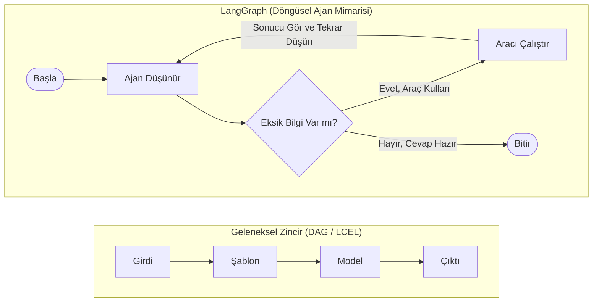

---

### 1.4 "Workflow" (İş Akışı) vs "Agent" (Ajan) Ayrımı

Her şeyi otonom ajan yapmak zorunda değilsiniz. LangGraph size bir **Otonomi Kadranı** sunar:
- **Sabit İş Akışı (Workflow):** Adımlar bellidir (`Araştır -> Özetle -> Formatla`), sadece aralarda kalite kontrol döngüsü vardır. Ucuz, hızlı ve öngörülebilirdir.
- **Yarı Otonom Ekip (Router / Supervisor):** Ana istasyonlar bellidir ama hangi istasyona kaç kez gidileceğine bir yönetici model karar verir.
- **Tam Otonom Ajan (ReAct Agent):** Elinde alet çantası vardır; hedefe ulaşana kadar hangi adımları atacağını tamamen kendisi planlar.

---

### 1.5 Arka Plandaki Motor: Google Pregel ve "Süper Adım" (Super-step) Mantığı

LangGraph rastgele yazılmış bir `while` döngüsü değildir. Kalbinde Google'ın milyarlarca web sayfasını işlemek için icat ettiği **Pregel** mimarisinden esinlenen bir **Süper Adım (`Super-step`)** motoru çalışır.

Bunu bir **film karesi** veya **satranç hamlesi** gibi düşünün:
1. **1. Süper Adım:** Aktif olan düğüm (veya paralel düğümler) uyanır, ortak panoyu okur, işini yapar ve panoya notunu bırakıp uyur.
2. **Mühürleme Anı:** Bir sonraki adıma geçilmeden hemen önce LangGraph zamanı dondurur! Panodaki yeni notları birleştirir ve veritabanına bir **kayıt noktası (Checkpoint)** yazar.
3. **2. Süper Adım:** Trafik kurallarına (Edge) göre sıradaki düğüm uyandırılır.

Bu "Adım -> Mühürle -> Adım -> Mühürle" ritmi sayesinde LangGraph'ta elektriği çekseniz bile ajan kaldığı kareden uyanır, zamanda geriye sarılabilir ve insan onayı için günlerce uyutulabilir!

---

## Bölüm 2: LangGraph'ın Anatomisi — State, Node ve Edge Üçlüsü

LangGraph ne kadar büyük bir holding simülasyonu kurarsa kursun, her şey sadece **üç temel yapı taşından** oluşur: **State (Durum)**, **Node (Düğüm)** ve **Edge (Kenar)**.

Bunu hiç unutmayacağınız tek bir metaforla zihnimize kazıyalım: **Bir Fabrika Üretim Bandı.**
- **State (Durum):** Fabrikanın ortasındaki **Ortak Beyaz Tahta (veya Üretim Dosyası)**.
- **Node (Düğüm):** İşi yapan **Uzman Ustalar / Makineler**.
- **Edge (Kenar):** Dosyayı bir ustadan diğerine taşıyan **Konveyör Bantlar ve Yön Tabelaları**.

---

### 2.1 State (Durum): Ortak Beyaz Tahta ve "Reducer" Mucizesi

Bir şirkette Araştırmacı, Yazılımcı ve CEO aynı odada nasıl anlaşır? Ortada duran ortak bir proje klasörüyle! LangGraph'ta bu ortak klasöre **State** denir.

#### Sık Sorulan Soru: Python'da `dict` (Sözlük) Nedir ve Ustalar Neden Sadece Küçük Bir `dict` Döndürür?
Derslerimizde [01_merhaba_langgraph.py](file:///c:/Users/aytgn/Desktop/LangGraph_Course/01_temel_egitim/01_merhaba_langgraph.py) dosyasının 27. satırını incelerken harika bir soru sormuştunuz: *"Buradaki `dict` nedir ve düğüm neden tüm State'i değil de tek elemanlı bir sözlük döndürüyor?"*

Python'da `dict` (`{"anahtar": "değer"}`), etiketli çekmecelerden oluşan bir kutudur. Örneğin `CourseState` tahtamızda iki çekmece olsun:
- `lesson_topic`: `"LangGraph Temelleri"`
- `messages`: `[Kullanıcı sorusu, ...]`

Eğitmen düğümü (`instructor_node`) işini bitirdiğinde bütün beyaz tahtayı söküp yeniden getirmek zorunda değildir! Sadece `{"messages": [yeni_cevap]}` şeklinde küçük bir post-it kağıdı uzatır ve *"Ben sadece `messages` çekmecesini güncelledim, `lesson_topic` çekmecesine dokunmayın"* der.

#### Büyük Tehlike: Silgiyle Silmek (Overwrite) vs Altına Eklemek (`Reducer`)
Normalde bir beyaz tahtada `"Mesajlar"` kutusuna yeni bir cümle yazarsanız, eski yazıyı silip üstüne yazmış olursunuz (`Overwrite`). Eğer Eğitmen kendi cevabını yazarken öğrencinin sorusunu silerse, bir sonraki adımda gelen Eleştirmen (`critic_node`) öğrencinin ne sorduğunu göremez!

İşte LangGraph'taki **Reducer (Birleştirici Kural)** tam olarak bu çekmecenin kapağına yapıştırılan talimattır:

```python
class CourseState(TypedDict):
    messages: Annotated[list[BaseMessage], add_messages]  # Altına ekle (Silme!)
    lesson_topic: str                                     # Üzerine yaz (Güncelle)
```

Buradaki iki satır arasındaki devasa farka bakın:
- `lesson_topic: str` çekmecesinde özel bir kural yoktur. Bir düğüm yeni bir konu gönderirse eskisi silinir, yenisi yazılır. (Örn: `"Sıradaki çalışan: Coder"` bilgisi için üzerine yazmak tam istediğimiz şeydir!)
- `Annotated[..., add_messages]` çekmecesinde ise **`add_messages`** adında akıllı bir arşiv memuru nöbet tutar. Hangi düğüm yeni bir mesaj gönderirse göndersin, arşiv memuru eski mesajları korur ve yenisini listenin **en altına ekler** (hatta aynı ID'ye sahip bir mesaj düzeltildiyse onu akıllıca günceller!).

> [!TIP]
> **Kısa Yol (`MessagesState`):** Sadece mesaj listesi tutan basit bir graf kuruyorsanız, `TypedDict` ve `add_messages` satırlarını uzun uzun yazmak yerine LangGraph'ın hazır sunduğu `MessagesState` sınıfını doğrudan kullanabilirsiniz. İçinde `add_messages` takılı olarak hazır gelir!

#### Mesaj Ailesi: Tahtadaki Konuşmacıların Yaka Kartları
`messages` listesinin içindeki metinler düz yazı değil, kimden geldiği belli olan zarflardır:
1. **`SystemMessage` (Anayasa / Rol Kartı):** Modele kim olduğunu söyler (*"Sen Kıdemli Finans Denetçisisin"*).
2. **`HumanMessage` (İnsan / Görev Direktifi):** Kullanıcının talebidir (*"Apple hissesini hesapla"*).
3. **`AIMessage` (Modelin Yanıtı veya Kararı):** Yapay zekanın ürettiği cevaptır (veya çağırmak istediği aracın sipariş fişidir).
4. **`ToolMessage` (Kanıt / Araç Sonucu):** Çalışan Python fonksiyonunun getirdiği gerçek veridir (*"AAPL: 230.10 USD"*).

#### `TypedDict` mi, `Pydantic` mi?
State tanımlarken iki seçeneğiniz vardır:
- **`TypedDict`:** Tüy gibi hafiftir, çalışma anında yavaşlatma yapmaz. LangGraph'ta graf içi State tanımlarken endüstri standardıdır.
- **`Pydantic (BaseModel)`:** Sıkı güvenlik görevlisidir. Bir alana sayı yerine harf gelirse anında hata fırlatır veya dönüştürür. Özellikle **dış dünyadan gelen girdileri doğrularken** ve **LLM'den yapılandırılmış karar alırken (`RouteDecision`)** vazgeçilmezdir.

---

### 2.2 Nodes (Düğümler) ve Edges (Kenarlar): En Çok Karıştırılan Ayrım!

Eğitimimiz sırasında sorduğunuz şu soru, LangGraph öğrenen herkesin aklından geçen ama kimsenin sormaya cesaret edemediği en kilit soruydu:
> *"Ben `def` ile fonksiyonu tanımlıyorum, sonra `workflow.add_node` yapıyorum, sonra bir de `workflow.add_edge` yapıyorum. Edge'de zaten birbirine bağlıyorsam `add_node` ile nereye ve niye ekliyorum?"*

Gel, bunu **Fabrika Kurulumunun 3 Aşaması** ile sonsuza dek netleştirelim:

1. **`def instructor_node(state): ...` (Makineyi İcat Etmek):**
   Bu aşamada makine hala sizin bilgisayarınızdaki sıradan bir Python fonksiyonudur. LangGraph'ın bu fonksiyondan **haberi bile yoktur.** Makine henüz fabrikanın dışındaki depoda duruyordur.
2. **`workflow.add_node("instructor", instructor_node)` (Makineyi Fabrika Zeminine Monte Etmek ve İsim Plakası Takmak):**
   Depodaki makineyi alıp fabrikanın içine getirir, yere vidalar ve üzerine **`"instructor"`** yazılı resmi bir tabela asarsınız. Artık LangGraph fabrikasında bu isimde resmi bir istasyon vardır, ama henüz hiçbir yere kablosu veya bandı bağlı değildir.
3. **`workflow.add_edge("instructor", "critic")` (İstasyonlar Arasına Konveyör Bant Çekmek):**
   Artık fonksiyonların kendisiyle değil, taktığınız **isim tabelalarıyla** konuşursunuz: *"`instructor` istasyonundan çıkan dosyayı `critic` istasyonuna götüren bir bant döşe!"*

Neden bu ikisi ayrıdır? Çünkü aynı makine fonksiyonunu fabrikada iki farklı isimle iki ayrı istasyon olarak kurabilirsiniz veya bir istasyona üç farklı yerden bant bağlayabilirsiniz!

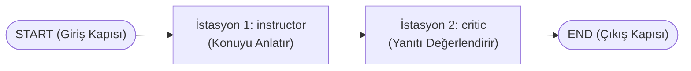

*Canlı Örnek:* İlk dersimiz olan [01_merhaba_langgraph.py](file:///c:/Users/aytgn/Desktop/LangGraph_Course/01_temel_egitim/01_merhaba_langgraph.py) dosyasında tam olarak yukarıdaki akışı kurmuştuk. Öğrenci merhaba diyor (`START`), Eğitmen hoş geldin mesajı yazıp ortak panoya ekliyor (`instructor`), bant dosyayı Eleştirmene taşıyor (`critic`), Eleştirmen eğitmenin cevabını okuyup motive edici koçluk notunu ekliyor ve kapıdan çıkıyor (`END`).

---

### 2.3 Derleme (`compile`) ve Canlı Yayın (`invoke` vs `stream`)

Tüm istasyonları yerleştirdiniz ve bantları çektiniz. Son satırda neden **`app = workflow.compile()`** yazarız?

`compile()` fabrikanın **Yapı Denetim Mühendisi**dir. Şalteri kaldırmadan önce planı inceler:
- *"Hiçbir bandın gitmediği hayalet bir istasyon unuttun mu?"*
- *"Olmayan bir istasyon ismine bant çektin mi?"*
- *"Hafıza kasasını (Checkpointer) ve güvenlik frenlerini (Interrupt) nereye bağlayacağım?"*

Denetimden geçince elinize çalışmaya hazır `app` motorunu verir. Bu motoru iki farklı şekilde çalıştırabilirsiniz:

| Çalıştırma Yöntemi | Günlük Hayat Karşılığı | Ne Zaman Kullanılır? |
| :--- | :--- | :--- |
| **`app.invoke(girdi)`** | Restoranda sipariş verip yemek masaya gelene kadar beklemek. | Arka plan işlerinde, API yanıtlarında, sadece nihai sonuç gerektiğinde. |
| **`app.stream(girdi)`** | Açık mutfaklı restoranda aşçının hamuru açmasını, sosu dökmesini ve fırına sürmesini anbean izlemek. | Kullanıcı arayüzlerinde, ajanların hangi aracı çağırdığını canlı gösterirken! |

Üstelik `stream` yaparken kameranın nereye odaklanacağını (`stream_mode`) seçebilirsiniz:
- **`values`:** Her adımdan sonra beyaz tahtanın **tamamının** fotoğrafını gönderir ([02_tool_react_ajani.py](file:///c:/Users/aytgn/Desktop/LangGraph_Course/01_temel_egitim/02_tool_react_ajani.py) içinde kullandığımız mod).
- **`updates`:** Sadece o adımda çalışan ustanın yapıştırdığı **yeni post-it'i** gönderir (Çok daha hafif ve popülerdir).
- **`messages`:** ChatGPT gibi kelimelerin ekrana **harf harf / token token** akmasını sağlar!
- **`custom`:** Düğümün içinden kullanıcı ekranına *"Şu an piyasa verilerinin %60'ı tarandı..."* gibi özel durum mesajları fırlatır.

---

# KISIM II: AJANLARA EL, KOL VE MUHAKEME KAZANDIRMAK

## Bölüm 3: Araç Çağırma (Tool Calling), ReAct Felsefesi ve Yapılandırılmış Kararlar

Birinci bölümde kavanozdaki dahi beyinden (LLM) bahsetmiştik. Şimdi bu beyne gerçek dünyada iş yapabilecek **eller ve kollar (Tools)** takıyoruz. Ancak burası, geliştiricilerin %80'inin yanlış anladığı, sizin ise yan sorularınızla tam kalbinden yakaladığınız noktadır!

---

### 3.1 Büyük Sır: LLM Hangi Fonksiyonu Çağıracağını NASIL Anlar?

Eğitimimiz sırasında [02_tool_react_ajani.py](file:///c:/Users/aytgn/Desktop/LangGraph_Course/01_temel_egitim/02_tool_react_ajani.py) çalışırken harika bir soru sormuştunuz:
> *"'Benim bunu cevaplamak için `get_company_stock_price` fonksiyonunu çağırmam gerek' dedin ya... Model bunu NASIL anlar?"*

Birçok kişi yapay zekanın bizim Python kodumuzun içini okuduğunu veya fonksiyonu kendi başına çalıştırdığını sanır. **İkisi de yanlıştır!** Gelin perde arkasındaki 4 adımlık sihri tüm çıplaklığıyla görelim:

#### Adım 1: `@tool` Dekoratörü Python Fonksiyonunu Bir "Menü Kartına" Çevirir
Siz Python'da şu üç satırlık fonksiyonu yazdığınızda:

```python
@tool
def get_company_stock_price(ticker: str) -> str:
    """Belirtilen hisse senedi kodunun (ticker) anlık fiyatını getirir."""
    ...
```

`@tool` etiketi fonksiyonun içindeki Python kodlarını **hiç umursamaz!** Onun yerine üç şeye bakar:
1. **Fonksiyonun Adı:** `get_company_stock_price`
2. **Parametre Tipleri:** `ticker` adında bir metin (`str`) istiyor.
3. **Docstring (Üç tırnak içindeki açıklama):** *"Belirtilen hisse senedi kodunun anlık fiyatını getirir."*

Ve bunları arka planda evrensel bir **JSON Menü Kartına (JSON Schema)** dönüştürür!

> [!WARNING]
> **Docstring Hayati Önem Taşır!** Klasik yazılımda fonksiyon açıklamaları (docstring) diğer yazılımcılar okusun diye yazılır; yazmasanız da kod çalışır. Ajan mimarisinde ise **docstring, yapay zekanın o aracı ne zaman seçeceğini okuduğu tek kullanma kılavuzudur!** Kötü veya boş bir docstring yazarsanız, en zeki model bile elindeki tornavidayla çivi çakmaya çalışır.

#### Adım 2: `bind_tools` Modele Alet Çantasının Kataloğunu Uzatır
`llm.bind_tools(tools)` dediğinizde, her soru sorduğunuzda modele gizlice şu katalog gider:
*"Bak sevgili Gemini, kullanıcı sana bir soru soracak. İstersen doğrudan Türkçe cevap ver; AMA elinde şu 4 aletin kataloğu var: `get_company_stock_price`, `convert_currency`, `calculate_growth_rate`, `get_company_employee_count`. Eğer cevabı bilmiyorsan uydurma, katalogdan uygun aleti seçip bana sipariş fişi yaz!"*

#### Adım 3: LLM Kodu Çalıştırmaz, Sadece "Sipariş Fişi" (`tool_calls`) Yazar!
Kullanıcı *"Apple (AAPL) hisse fiyatı kaç dolar?"* dediğinde Gemini'nin içinde Python çalışmaz. Gemini metin üretmek yerine özel bir veri paketi (`AIMessage` içinde `tool_calls`) üretir:
- **Seçilen Alet:** `get_company_stock_price`
- **Argümanlar:** `{"ticker": "AAPL"}`

Yani model aslında garson gibi mutfağa bir **sipariş fişi** uzatmıştır!

#### Adım 4: `ToolNode` Mutfağa Girer ve Gerçek Kodu Çalıştırır
LangGraph'taki hazır **`ToolNode`** bileşeni bizim mutfak şefimizdir. Modelin uzattığı sipariş fişini alır, bilgisayarınızdaki gerçek Python fonksiyonunu `ticker="AAPL"` ile çalıştırır, çıkan `"$230.10"` cevabını bir `ToolMessage` zarfına koyup tekrar beyaz tahtaya (`State`) asar!

---

### 3.2 İkinci Büyük Sır: `tools_condition` Yapay Zeka mıdır?

Yine ders esnasında sorduğunuz o nokta atışı soruyu hatırlayalım:
> *"`tools_condition` hazır mı? Kendi mi anlıyor hangi koşulda tetikleneceğini?"*

Evet, LangGraph'ın içinde hazır gelir **ve içinde zerre kadar yapay zeka yoktur!** Sıfır token harcar, milisaniyenin binde birinde çalışır. Yaptığı tek iş, beyaz tahtadaki son mesaja bakıp şu basit trafik polisliğini yapmaktır:
- *"Son mesajın elinde bir **sipariş fişi (`tool_calls`)** var mı?"*
  - **Varsa:** Yolu mutfağa (`"tools"` düğümüne) çevir!
  - **Yoksa:** Demek ki model nihai cevabını yazmış, yolu çıkış kapısına (`END`) çevir!

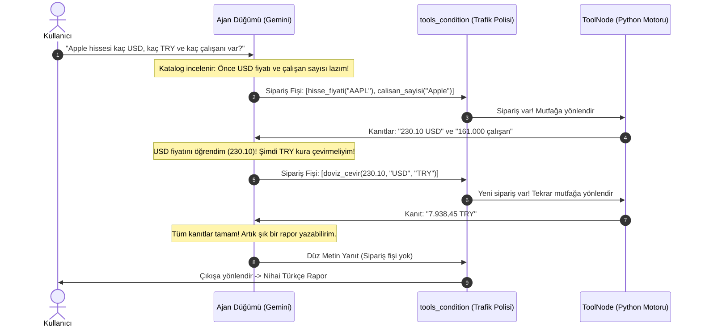

---

### 3.3 ReAct (Reason + Act) Felsefesi: Paralel Zeka vs Ardışık Zeka

Yukarıdaki şemaya dikkatle bakın! [02_tool_react_ajani.py](file:///c:/Users/aytgn/Desktop/LangGraph_Course/01_temel_egitim/02_tool_react_ajani.py) testimizde tek bir soruyla hem **Paralel Araç Çağırmayı** hem de **Ardışık Çok Adımlı Muhakemeyi (Multi-hop Reasoning)** aynı anda görmüştük:

1. **Paralel Akıl:** Apple'ın dolar bazındaki hisse fiyatı ile çalışan sayısı birbirinden bağımsızdır. Gemini tek bir düşünme adımında **iki sipariş fişini aynı anda** keser; `ToolNode` ikisini paralel çalıştırıp zamandan tasarruf eder!
2. **Ardışık (Bağımlı) Akıl:** Peki neden ilk adımda döviz çevirme (`convert_currency`) aracını da çağırmadı? Çünkü kaç doları çevireceğini **henüz bilmiyordu!** Önce `230.10` rakamının mutfaktan dönmesini bekledi, döngüsel kenar (`tools -> agent`) sayesinde bu rakamı okudu ve ikinci turda `230.10` sayısını döviz aracına gönderdi!

İşte literatürde **ReAct (`Reasoning` = Düşünme + `Acting` = Eyleme Geçme)** denilen devrim tam olarak budur. Ve fark ettiyseniz: `tools` düğümünden `agent` düğümüne geri dönen o küçücük ok olmasaydı, ajan ikinci adımı asla atamazdı!

---

### 3.4 Gelişmiş İpucu: `InjectedState` (Araca Gizli Belge Uzatmak)

Peki ya bir aracın çalışması için kullanıcının kimlik numarası (`user_id`) veya şirket yetki seviyesi gerekiyorsa ama **LLM'in bu karmaşık kimlik numarasını tahmin etmesini veya uydurmasını istemiyorsak?**

LangGraph'ta **`InjectedState`** adında muazzam bir güvenlik numarası vardır. Aracın parametresini `InjectedState` olarak işaretlediğinizde, bu parametre LLM'e giden "Menü Kartından" gizlenir! LLM sadece işiyle ilgili parametreyi doldurur; `user_id` bilgisini ise `ToolNode` doğrudan güvenli beyaz tahtadan (`State`) alıp fonksiyona enjekte eder. Böylece hem token tasarrufu sağlanır hem de yapay zekanın başkasının kullanıcı numarasını uydurma (halüsinasyon / güvenlik açığı) ihtimali sıfırlanır.

---

### 3.5 Yapılandırılmış Çıktı (`with_structured_output`): Şairi Memura Dönüştürmek

Bazen yapay zekanın uzun cümleler kurmasını değil, sadece bir form doldurmasını istersiniz. Örneğin bir yöneticinin (Supervisor) *"Hmm, bence şimdi araştırmacı arkadaşımız bir baksın bakalım..."* gibi geveze bir paragraf yazması kodunuzu bozar; siz ondan net olarak sadece `"Researcher"`, `"Coder"` veya `"FINISH"` kelimelerinden birini seçmesini istersiniz.

İşte `Pydantic` ile bir kalıp çizip modele **`llm.with_structured_output(RouteDecision)`** dediğinizde, modelin elinden serbest kağıdı alıp önüne **kutucuklu resmi bir form** koyarsınız:

```python
class RouteDecision(BaseModel):
    next: Literal["Researcher", "Coder", "FINISH"]
    reason: str
```

Artık model istese de bu üç seçenek dışında bir harf üretemez! Çoklu ajan sistemlerinde (Modül 3 ve Modül 5) departmanlar arası yönlendirmenin sıfır hatayla çalışmasının sırrı bu kilit mekanizmadır.

---

### 3.6 Hazır Paket (`create_react_agent`) vs Özel Mimari (`StateGraph`)

LangGraph size `langgraph.prebuilt` altında `create_react_agent(model, tools)` adında tek satırlık hazır bir fabrika da sunar. Bu fonksiyon az önce öğrendiğimiz `agent` düğümünü, `ToolNode` mutfağını ve `tools_condition` döngüsünü sizin yerinize arka planda otomatik kurar.

**Peki ne zaman hangisini seçmelisiniz?**
- **Hızlı bir prototip veya tek kişilik uzman bir işçi ajan** kuruyorsanız: `create_react_agent` harika bir kısayoldur.
- **Özel şirket kuralları, çoklu departmanlar, özel State alanları (`allocated_budget`, `is_audit_passed`) ve özel güvenlik kapıları** kuruyorsanız: Doğrudan `StateGraph` ile kendi fabrikanızı çizmek size sınırsız kontrol gücü verir.


---

# KISIM III: ZAMAN, HAFIZA VE İNSAN KONTROLÜ (İLERİ RUNTIME)

## Bölüm 4: Kalıcılık (Persistence), Checkpointer Mimarisi ve Kısa/Uzun Süreli Hafıza

Modül 1'de kurduğumuz ajanlar zekiydi ama ölümcül bir kusurları vardı: **Program kapandığı (hatta tek bir `invoke` çağrısı bittiği) saniye her şeyi unutuyorlardı.**

Gerçek bir şirkette sabah konuştuğunuz çalışanınız öğleden sonra yanınıza gelip *"Pardon, siz kimdiniz ve biz hangi projeyi yapıyorduk?"* derse o şirket batar. İşte LangGraph'ı basit bir oyuncaktan kurumsal bir işletim sistemine dönüştüren katman **Persistence (Kalıcılık)** katmanıdır.

---

### 4.1 Checkpointer Nedir? (Video Oyunu "Auto-Save" Metaforu)

Zorlu bir bilgisayar oyunu oynadığınızı düşünün. Her bölümü geçtiğinizde ekranın köşesinde küçük bir disk simgesi döner: **"Oyun Kaydedildi (Checkpoint Reached)."** Elektrikler kesilse de, bilgisayarı kapatıp ertesi hafta açsanız da oyuna en baştan değil, tam o kapının önünden, cebinizdeki aynı altınlarla ve aynı can puanıyla devam edersiniz.

LangGraph'ta **`Checkpointer`** tam olarak budur! Grafı derlerken ona bir kayıt motoru bağladığınızda (`workflow.compile(checkpointer=memory)`), LangGraph her **Süper Adım** bittiğinde beyaz tahtanın (`State`) eksiksiz bir fotoğrafını çeker, üzerine bir zaman damgası (`checkpoint_id`) vurur ve kasaya kilitler.

---

### 4.2 Üç Büyük Hafıza Kasası (Ve Klasörümüzdeki `.db-wal` Dosyalarının Sırrı!)

İhtiyacınıza göre LangGraph'a üç farklı kasa takabilirsiniz (kodunuzda tek bir satır bile değiştirmeden!):

| Kasa Türü | Günlük Hayat Karşılığı | Ne Zaman Kullanılır? |
| :--- | :--- | :--- |
| **`MemorySaver` (`InMemorySaver`)** | Okul sırasının üzerindeki karalama kağıdı. Zil çalıp program kapanınca çöpe gider (RAM'de yaşar). | Hızlı denemeler, eğitim testleri, geçici tek seferlik görevler. |
| **`SqliteSaver`** | Evinizdeki veya ofisinizdeki çelik kasa (`.db` dosyası). Bilgisayar yeniden başlasa bile her şey yerindedir. | Masaüstü uygulamaları, kişisel danışman ajanlar, tek sunuculu projeler ([01_hafizali_ajan.py](file:///c:/Users/aytgn/Desktop/LangGraph_Course/02_derinlesme_runtime/01_hafizali_ajan.py)). |
| **`PostgresSaver`** | Merkez Bankası'nın buluttaki dev mahzeni. Saniyede on binlerce okuma/yazmayı aynı anda kaldırır. | Gerçek müşterilere hizmet veren, birden fazla sunucuda çalışan kurumsal SaaS ve şirket sistemleri. |

#### Klasörünüzde Gördüğünüz `checkpoints.db`, `-wal` ve `-shm` Dosyalarının İçinde Ne Var?
Projemizde Modül 2, 3, 4 ve 5'i çalıştırdığımızda klasörlerinizde `checkpoints.db`, `checkpoints.db-wal` ve `checkpoints.db-shm` dosyaları oluştu. Bunların ne işe yaradığını bilmek size müthiş bir mühendislik özgüveni kazandırır:
- **`checkpoints` tablosu:** Her adımın tam fotoğrafını, hangi oturuma (`thread_id`) ait olduğunu ve bir önceki fotoğrafın kimliğini (`parent_checkpoint_id`) tutar.
- **`writes` tablosu:** O an paralel çalışan ustaların henüz birleştirilmemiş ara notlarını tutar. Bir usta hata verse bile diğer ustanın emeği yanmaz (**Hata Toleransı / Fault Tolerance**)!
- **`.db-wal` (Write-Ahead Log) ve `.db-shm` (Shared Memory):** SQLite'ın yüksek hız modudur. Biri kasadan okuma yaparken diğerinin beklememesi için yeni kayıtlar önce yıldırım hızıyla `-wal` günlüğüne yazılır, ardından ana kasaya aktarılır.

---

### 4.3 `thread_id`: Çoklu Kullanıcı İzolasyonu (CEO Ahmet vs Muhasebeci Mehmet)

Şimdi çok kritik bir soru soralım: *Şirketimizde tek bir LangGraph motoru çalışıyor ama aynı anda 100 farklı çalışan bu motorla konuşuyor. Birinin sırrı diğerine nasıl sızmıyor?*

Cevap: **`thread_id` (Oturum Anahtarı)**.

Bankadaki kiralık kasaları düşünün. Banka binası tektir (`app`), ama her müşterinin elinde kendi kasa numarasının anahtarı vardır (`thread_id`). [01_hafizali_ajan.py](file:///c:/Users/aytgn/Desktop/LangGraph_Course/02_derinlesme_runtime/01_hafizali_ajan.py) içinde canlı test ettiğimiz o çarpıcı senaryoyu hatırlayın:

```python
config_ahmet  = {"configurable": {"thread_id": "oturum-ahmet-ceo"}}
config_mehmet = {"configurable": {"thread_id": "oturum-mehmet-muhasebe"}}
```

1. **Ahmet (CEO)** kendi anahtarıyla girip *"Ben CEO Ahmet'im, gizli bütçemiz 5 Milyon TL"* dedi.
2. Hemen bir saniye sonra **Mehmet (Muhasebe)** kendi anahtarıyla aynı ajana *"Ben kimim ve gizli bütçemiz ne?"* diye sordu. Ajan: *"Kendinizi henüz tanıtmadınız, herhangi bir bütçe bilgisine sahip değilim"* dedi!
3. **Ahmet** tekrar kendi anahtarıyla döndüğünde ise ajan onu ismen karşılayıp *5 Milyon TL* bütçeyi şak diye hatırladı!

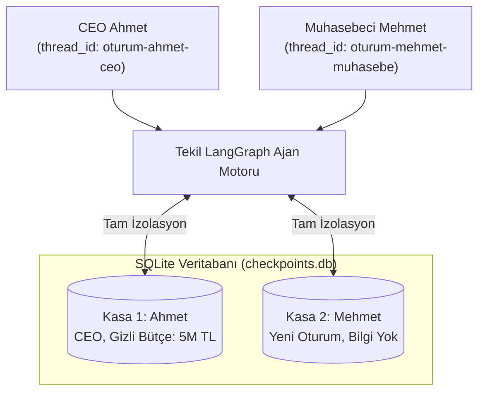

---

### 4.4 Kısa Süreli Hafıza (`Checkpointer`) vs Uzun Süreli Hafıza (`LangGraph Store`)

Burada çoğu eğitimin atladığı ama sizin **"Kişisel Danışman Ajan"** vizyonunuz için hayati olan bir ayrım vardır!

`thread_id` ile çalışan **Checkpointer**, WhatsApp'taki **tek bir sohbet penceresinin** geçmişidir (Kısa Süreli / Oturum İçi Hafıza). Peki ya CEO Ahmet pazartesi günü `"proje-alfa"` sohbetini kapatıp salı günü `"proje-beta"` adında **yepyeni bir `thread_id`** başlatırsa ne olur? Yeni bir kasa açıldığı için ajan Ahmet'in raporları kısa ve maddeler halinde sevdiğini unutur!

İşte LangGraph bu sorunu çözmek için **`Store` (Uzun Süreli / Oturumlar Arası Hafıza)** bileşenini sunar:
- **Checkpointer (`thread_id` bazlı):** *"Şu an üzerinde konuştuğumuz işin adımları neler?"* (Çalışma Masası).
- **LangGraph Store (`user_id` veya `company` isim alanı / namespace bazlı):** *"Bu kullanıcı kimdir, huyu suyu nedir, geçmiş projelerde hangi dersleri çıkardık?"* (Kalıcı Şirket Arşivi).

Bilişsel bilimden esinlenerek ajanlarınıza **3 tip Uzun Süreli Hafıza** kazandırabilirsiniz:
1. **Semantik Hafıza (Gerçekler & Profil):** *"Kullanıcı Python sever, IDE kullanmaz, bir Vibe Coder'dır, temiz alan adlarını tercih eder."*
2. **Epizodik Hafıza (Anılar & Deneyimler):** *"Geçen ay finans raporu hazırlarken enflasyon payını unutmuştuk ve kullanıcı düzeltmişti; bir dahaki sefere unutma."*
3. **Prosedürel Hafıza (Öz-Evrimleşen Kurallar):** Ajanın zamanla kendi sistem talimatlarını (`System Prompt`) aldığı geri bildirimlere göre güncelleyip ustalaşması!

---

### 4.5 Şişen Hafıza Sorunu: Bağlam Penceresi Hijyeni (Context Hygiene)

Bir sohbet oturumu 300 mesaj sürerse ne olur? Her adımda 300 mesajın tamamını Gemini'ye tekrar göndermek hem yanıt süresini yavaşlatır, hem token maliyetini katlar, hem de modelin dikkatini dağıtır. Profesyonel LangGraph mimarları bunu 3 teknikle çözer:
- **`trim_messages` (Kırpma):** Veritabanında her şeyi sakla ama modele sadece son 10 mesajı gönder.
- **`RemoveMessage` (Cerrahi Silme):** Artık işimize yaramayan devasa ham araç çıktılarını beyaz tahtadan temizle.
- **Özetleme Düğümü (Summarization Node):** Her 15 mesajda bir özel bir düğüm devreye girer, eski konuşmayı 3 cümlelik bir özete sıkıştırır (`summary` çekmecesine yazar) ve eski kalabalığı temizler. Böylece ajan **sonsuza kadar** düşük maliyetle ve keskin bir hafızayla konuşabilir!

---

## Bölüm 5: Human-in-the-Loop (İnsan Onayı), `Command` Mekanizması ve Zamanda Yolculuk

Otonom bir ajan kurmak heyecan vericidir; ta ki ajanınız yanlış anlayıp tedarikçiye **150.000 TL yerine 1.500.000 TL** havale çıkarana veya üretim veritabanındaki müşteri tablosunu silene kadar!

Gerçek dünyada en değerli ajan, hiç durmadan koşturan ajan değil; **ne zaman durup sahibine sorması gerektiğini bilen ajandır.** Buna **Human-in-the-Loop (HITL — Döngüdeki İnsan)** denir.

---

### 5.1 Neden Basit Bir `input("Onaylıyor musunuz?")` Kodu Kurumsal Hayatta Çalışmaz?

Acemi yazılımcılar insan onayı almak için Python'un klasik konsol bekletme komutunu kullanmayı düşünür. Oysa gerçek bir web sunucusunda veya Slack botunda patronun o onay butonuna basması **5 dakika da sürebilir, 3 gün de sürebilir!**

Klasik bir programı 3 gün boyunca RAM'de açık bekletirseniz sunucu kilitlenir, yeniden başlatılırsa her şey uçar. **LangGraph'ın mucizesi şudur:** Ajan duraklatıldığı saniye tüm hafızasını SQLite/Postgres kasasına yazar ve **işlemciyi tamamen serbest bırakıp uykuya yatar!** İster 10 saniye sonra, ister 10 gün sonra onay verin; LangGraph kasayı açar, kaldığı milisaniyeden uyanır ve işine devam eder!

---

### 5.2 İki Farklı Fren Pedalı: Kapıdaki Turnike vs İçeriden El Kaldırma

LangGraph'ta bir ajanı durdurmanın iki zarif yolu vardır:

#### 1. Statik Fren: `interrupt_before` (Kapının Önüne Turnike Koymak)
[01_hafizali_ajan.py](file:///c:/Users/aytgn/Desktop/LangGraph_Course/02_derinlesme_runtime/01_hafizali_ajan.py) ve [sirket_motoru.py](file:///c:/Users/aytgn/Desktop/LangGraph_Course/05_otonom_ajan_sirketi/sirket_motoru.py) projelerimizde kullandığımız demir yumruk yöntemidir:

```python
app = workflow.compile(
    checkpointer=memory,
    interrupt_before=["Audit_Approval_Dept"]  # Bu odaya girmeden HEMEN ÖNCE dondur!
)
```

Ne zaman akış bütçe departmanının veya araç düğümünün kapısına dayansa, turnike otomatik kapanır! Ajan sipariş fişini hazırlamıştır (`250.000 TL bütçe tahsis et`), ama fiş henüz işleme konulmamıştır.

#### 2. Dinamik Fren: `interrupt()` Fonksiyonu (Düğümün İçinden El Kaldırmak)
Peki ya *"10.000 TL altındaki havaleleri sormadan yap, SADECE 10.000 TL üstündeyse durup patrona sor"* demek isterseniz? Kapıdaki turnike (`interrupt_before`) her geleni durdurur. Buna karşılık modern LangGraph'ın **`interrupt()`** fonksiyonu düğümün **içinde** istediğiniz bir `if` koşulunda çalışır:

```python
if tutar > 10000:
    onay = interrupt({"soru": f"{tutar} TL gönderilsin mi?"})
```

Ajan sadece meblağ yüksekse elini kaldırıp dondurulur! Patron cevabını verdiğinde ise `Command(resume="Evet")` komutuyla kaldığı satırdan yoluna devam eder.

---

### 5.3 İnsanın 4 Süper Yetkisi (Durmuş Bir Ajanla Neler Yapabilirsiniz?)

Graf duraklatıldığında `snapshot = app.get_state(config)` diyerek röntgen filmini elinize alırsınız. `snapshot.next` size kapıda kimin beklediğini söyler. Bu noktada bir yönetici olarak 4 seçeneğiniz vardır:

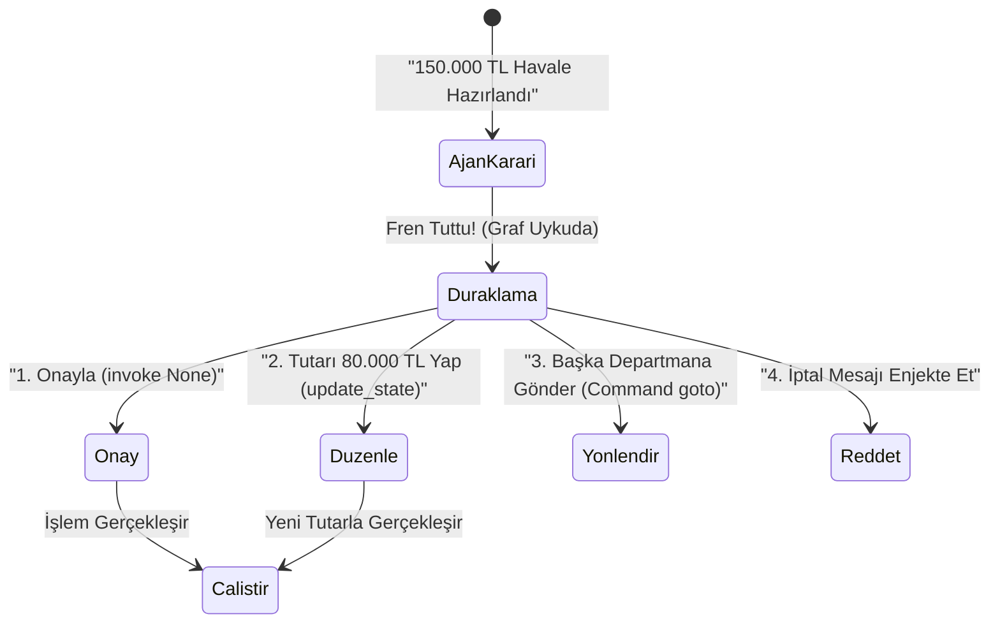

1. **Olduğu Gibi Onayla:** `app.invoke(None, config)` dersiniz. Buradaki `None`, *"Yeni bir soru sormuyorum, kapıyı aç, bekleyen işine devam et"* demektir!
2. **Beyaz Tahtayı Elle Değiştir (`update_state`):** Ajan 150.000 TL havale hazırlamış ama siz faturaya baktınız, doğrusu 80.000 TL! Ajanla tartışmak yerine doğrudan tahtaya uzanıp `app.update_state(...)` ile rakamı `80000` yaparsınız. Ajan uyandığında kendi kararının hep 80.000 TL olduğunu sanarak kusursuzca işlemi tamamlar! *(Hatta `as_node` parametresiyle tahtaya o notu hangi departman yazmış gibi görünmesini istediğinizi bile seçebilirsiniz.)*
3. **Rotayı Değiştir (`Command` Nesnesi):** Modern LangGraph'ta hem tahtayı güncelleyip hem de trafik polisini atlayarak doğrudan başka bir düğüme sıçramak için **`Command(update={...}, goto="Researcher")`** kullanılır. Bu, hem düğüm içinden hem de insan müdahalesinden kullanılabilen çok pratik bir "İsviçre çakısı"dır.
4. **Reddet / Geri Çevir:** Tahtaya *"Yönetici bu işlemi güvenlik nedeniyle reddetti"* şeklinde bir mesaj bırakıp akışı tekrar ajana döndürürsünüz; ajan da müşteriye kibarca işlemin onaylanmadığını açıklar.

---

### 5.4 Time-Travel Debugging: Zaman Makinesi ve Paralel Evrenler (Forking)

Bilim kurgu filmlerindeki "Çoklu Evren (Multiverse)" teorisinin yazılımdaki birebir karşılığı LangGraph'ın **Time-Travel (Zamanda Yolculuk)** özelliğidir!

Modül 2'yi çalıştırdığımızda Ahmet'in oturumunda arka arkaya checkpoint kayıtlarının biriktiğini görmüştük. `app.get_state_history(config)` dediğinizde ajanın doğduğu andan bugüne kadarki **tüm film şeridi** önünüze serilir.

Diyelim ki 10 adımlık karmaşık bir şirket görevinde ajan 4. adımda yanlış bir pazar verisine inandı ve kalan 6 adımda saçmaladı.
- **Klasik sistemlerde:** Her şeyi çöpe atar, 1. adımdan baştan çalıştırır ve dua edersiniz.
- **LangGraph'ta:** Film şeridini **3. adımdaki `checkpoint_id`'ye** geri sararsınız! Üstelik 3. adımdaki beyaz tahtada küçük bir düzeltme yapıp `invoke` tuşuna bastığınızda LangGraph eski geçmişi **silmez!** Tıpkı bir ağacın gövdesinden yeni bir dal çıkması gibi (**Forking / Dallandırma**), 3. adımdan itibaren **yeni bir paralel evren** başlatır!

> [!NOTE]
> **Neden Bu Bir Süper Güçtür?** Çünkü aynı müşteri senaryosunun 3. adımından itibaren *"Ya bu adımı Gemini Flash yerine Pro modeline yaptırsaydık?"* veya *"Ya bütçeyi farklı verseydik?"* diyerek ilk adımların parasını ve zamanını tekrar harcamadan saniyeler içinde A/B testi yapabilirsiniz!


---

# KISIM IV: BİLGİ SİSTEMLERİ, EKİP MİMARİLERİ VE OTONOM ŞİRKET

## Bölüm 6: Kopyala-Yapıştırın Sonu — Modern RAG, Agentic RAG, MCP ve Dinamik Beceriler

Sohbetlerimiz sırasında geleceğe dair kurduğunuz şu cümle, modern yapay zeka mühendisliğinin en can alıcı noktasını özetliyordu:
> *"Gemini'yi RAG mimarisiyle kullanma fikrim var ama... her şey için sürekli kopyala-yapıştır yapmak berbat bir fikir, yani modern değil :)"*

Kesinlikle haklısınız! 2026 dünyasında dokümanları elle kopyalayıp sohbet kutusuna yapıştırmak, araba varken kağnıyla yük taşımaya benzer. Gelin bir ajanın şirketinizin binlerce belgesine, kod deposuna ve canlı veritabanlarına **sıfır kopyala-yapıştır** ile nasıl bağlandığını en sade haliyle çözelim.

---

### 6.1 RAG (Retrieval-Augmented Generation) İnsan Dilinde Nedir?

Kavanozdaki dahi profesörümüzü (LLM) hatırlayın. Dünya tarihini bilir ama **sizin şirketinizin dün imzaladığı sözleşmeyi bilmez.** Ona bu sözleşmeyle ilgili soru sormanın iki yolu vardır:

1. **İlkel Yol (Her Şeyi Tıkıştırmak):** Şirketteki 5.000 sayfalık tüm PDF'leri her soruda modele baştan okutmak. Sonuç? Tek bir soru 40 saniye sürer, servet harcar ve model samanlıkta iğneyi kaçırır (*"Lost in the Middle"* sendromu).
2. **Modern Yol — RAG (Açık Kitap Sınavı):** Öğrenciye tüm kütüphaneyi ezberletmezsiniz. Sınavda soru geldiğinde akıllı bir kütüphaneci koşar, 5.000 sayfanın içinden **sadece o soruyla ilgili olan 3 paragrafı** cımbızla çekip öğrencinin sırasına koyar. Öğrenci de o 3 paragrafa bakarak sıfır halüsinasyonla cevabı yazar!

#### Kütüphaneci Doğru Paragrafı Nasıl Bulur? (Embeddings & Vektör Veritabanı)
Klasik arama (`Ctrl + F`) kelime eşleştirir: Siz *"Ücret iadesi"* aratırsınız, belgede *"Para geri ödemesi"* yazdığı için bulamaz!

RAG ise kelimeleri değil **anlamları** arar:
1. **Parçalama (`Chunking`):** Uzun belgeler anlamlı paragraflara bölünür.
2. **Anlam Koordinatı (`Embedding`):** Özel bir model her paragrafı uzayda bir koordinata (sayı dizisine) çevirir. Bu haritada *"Kral"* ile *"Hükümdar"*, *"Ücret iadesi"* ile *"Para geri ödemesi"* yan yana mahallelere düşer!
3. **Vektör Veritabanı (`Chroma`, `Qdrant`, `pgvector`, `Vertex AI Vector Search`):** Bu anlam haritasını saklayan özel kütüphanedir. Soru geldiğinde haritada en yakın 3 komşu paragraf milisaniyeler içinde çekilir.

---

### 6.2 Klasik RAG vs Agentic RAG (LangGraph Farkı!)

Peki kütüphanecinin ilk getirdiği 3 paragraf alakasız çıkarsa ne olur?
- **Klasik RAG (Düz Zincir / DAG):** Kör bir boru hattıdır. Kütüphaneci yanlış sayfayı getirse bile model o yanlış sayfadan cevap uydurmaya çalışır!
- **Agentic RAG / Corrective RAG (LangGraph Döngüsü):** LangGraph'ta bilgi arama işlemi kör bir boru değil, **denetlenen bir döngüdür!**

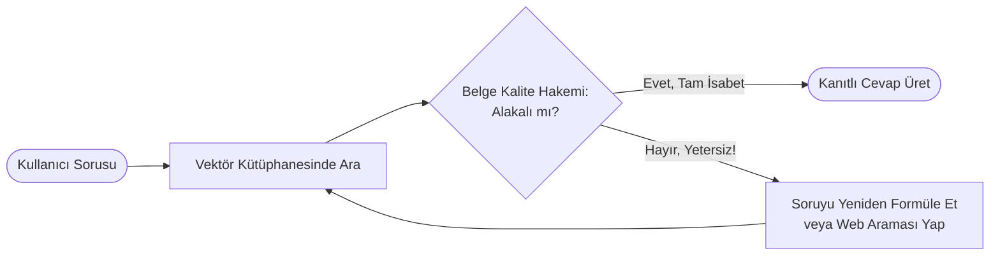

Gördünüz mü? LangGraph ajanı bulduğu belgeyi beğenmezse kendi arama terimini değiştirip kütüphaneye **ikinci kez** dalar, orada da bulamazsa canlı internete (`Tavily` / `Google Search`) çıkar! İşte buna **Kendi Kendini Düzelten RAG (Corrective / Self-RAG)** denir.

---

### 6.3 MCP (Model Context Protocol): Yapay Zekanın "USB-C" Girişi

Eskiden her telefon markasının şarj ucu farklıydı; çekmecelerimiz kablo çöplüğüydü. Sonra **USB-C** çıktı ve tek bir standart fişle her cihaz birbirine bağlandı.

Yapay zeka dünyasında **MCP (Model Context Protocol)** tam olarak o **evrensel USB-C girişidir!**
- Eskiden ajanınızı Google Drive'a bağlamak için ayrı kod, GitHub için ayrı kod, Slack için ayrı kod, yerel klasörleriniz için ayrı kod yazardınız.
- Bugün ise bu servislerin hepsi hazır **MCP Sunucuları (MCP Servers)** sunar. LangGraph'ın `langchain-mcp-adapters` köprüsü sayesinde ajanınıza tek satırla *"Bilgisayarımdaki proje klasörünü, GitHub repomu ve şirket veritabanımı MCP üzerinden bağla"* dersiniz. Siz tek bir kopyala-yapıştır yapmadan, danışman ajanınız canlı dosyalarınızı kendisi okur ve her şeyden anında haberdar olur!

---

### 6.4 Dinamik Beceriler (`Skills`) ve Kademeli Açığa Çıkarma (`Progressive Disclosure`)

Bu kursu başlatırken yaptığımız ilk ve en zekice hamleyi hatırlayın: Kursa başlamadan önce [`.agents/skills/`](file:///c:/Users/aytgn/Desktop/LangGraph_Course/.agents/skills/langgraph-curriculum-mentor/SKILL.md) klasörüne **5 ayrı uzmanlık becerisi (`SKILL.md`)** yerleştirdik. Ve o sırada iki muazzam soru sormuştunuz:
1. *"Skiller nasıl tetikleniyor?"*
2. *"Peki birden fazla skille uyuşursa ne yapıyor?"*

Bu sistemin arkasındaki mimari ilkenin adı **Progressive Disclosure (Kademeli Açığa Çıkarma)**'dır ve bunu hem asistan kullanırken hem de **kendi LangGraph ajanlarınızı tasarlarken** bilmeniz altın değerindedir:

- **Nasıl Tetiklenir?** Bir ajana 50 tane 10 sayfalık kullanma kılavuzunu baştan okutursanız beyni yanar ve token kotanız ilk dakikada biter. Onun yerine ajan başlangıçta her becerinin sadece **2 cümlelik yaka kartını (`name` ve `description`)** görür. Ne zaman siz *"Hadi LangSmith ile maliyet izleyelim"* derseniz, ajan yaka kartlarına bakar, sadece [langsmith-observability](file:///c:/Users/aytgn/Desktop/LangGraph_Course/.agents/skills/langsmith-observability/SKILL.md) dosyasının kapağını açıp içindeki detaylı talimatları o an okur!
- **Birden Fazla Beceri Eşleşirse Ne Olur?**
  - **Tamamlayıcıysa (İşbirliği):** Örneğin *"Eğitmen gibi davranarak Supervisor ekibi kur"* dediğinizde, hem [langgraph-curriculum-mentor](file:///c:/Users/aytgn/Desktop/LangGraph_Course/.agents/skills/langgraph-curriculum-mentor/SKILL.md) (Nasıl öğreteceği) hem de [langgraph-multi-agent-architectures](file:///c:/Users/aytgn/Desktop/LangGraph_Course/.agents/skills/langgraph-multi-agent-architectures/SKILL.md) (Nasıl mimari kuracağı) becerilerini **aynı anda** okur ve harmanlar.
  - **Çakışıyorsa (Öncelik Hiyerarşisi):** Aynı isimli hem genel bilgisayarınızda (Global) hem de proje klasörünüzde (Workspace) iki kural varsa, **her zaman en yerel olan (Proje içi kural)** genel kuralı ezer!

---

## Bölüm 7: Tek Beyinden Orkestraya — 6 Çoklu Ajan Deseni, Subgraph'lar ve `Send` API

Bir şirketi tek bir kişinin yönettiğini hayal edin: Sabah pazar araştırması yapıyor, öğlen Python kodu yazıyor, ikindi vakti muhasebe defteri tutuyor, akşam müşteri telefonlarına bakıyor... Bir süre sonra telefonları karıştırır, yanlış faturayı öder ve tükenir!

Yapay zekada da **tek bir ajana 25 farklı araç ve 5 sayfalık sistem talimatı yüklediğinizde ("God Agent" sendromu)** şu üç felaket yaşanır:
1. **Bağlam Kirliliği (`Context Bloat`):** Araştırma sırasındaki uzun ham metinler kod yazma aşamasında modelin dikkatini dağıtır.
2. **Araç Karmaşası (`Tool Confusion`):** Seçenek sayısı arttıkça modelin yanlış aracı seçme ihtimali katlanarak artar.
3. **Kişilik Bölünmesi:** İyi bir beyin fırtınası ajanı *yaratıcı ve esnek* (`temperature=0.7`) olmalıdır; iyi bir finans denetçisi ise *şüpheci ve sıfır toleranslı* (`temperature=0.0`) olmalıdır. Tek bir model aynı anda ikisi birden olamaz!

Çözüm: **İşi uzmanlara bölmek (Multi-Agent Architectures).** LangGraph dünyasında bilmeniz gereken **6 temel ekip deseni** vardır:

---

### Desen 1: Yansıma / Eleştirmen İkilisi (`Reflection` / `Evaluator-Optimizer`)
İlk dersimiz [01_merhaba_langgraph.py](file:///c:/Users/aytgn/Desktop/LangGraph_Course/01_temel_egitim/01_merhaba_langgraph.py) içinde tohumunu attığımız modeldir. Bir ajan üretir (Yazar/Kodlayıcı), ikinci ajan acımasız bir kalite kontrolcü gibi inceler (Eleştirmen). Kalite barajı geçilmediyse düzeltme notlarıyla birinci ajana geri gönderir!

### Desen 2: Merkezi Yönetici (`Supervisor Pattern`)
Modül 3'teki [01_supervisor_ekibi.py](file:///c:/Users/aytgn/Desktop/LangGraph_Course/03_ekip_mimarisi/01_supervisor_ekibi.py) projemizin tam kalbidir. Ortada elini koda veya aramaya sürmeyen bir **Proje Yöneticisi (`Supervisor`)** oturur:
- İşi inceler, `RouteDecision` formuyla `"Researcher"` uzmanına paslar.
- **Altın Kural (Geri Raporlama Döngüsü):** Araştırmacı işini bitirince doğrudan yazılımcıya gitmez; raporuyla birlikte **tekrar Yöneticinin masasına döner!** Yönetici raporu okur, tatmin olduysa bu kez `"Coder"` uzmanını görevlendirir. Her şey tamamsa `"FINISH"` mührünü basar.

### Desen 3: Hiyerarşik Ekipler ve Alt Graflar (`Hierarchical Teams & Subgraphs`)
Şirketiniz büyüdü ve artık 2 değil, 15 uzman ajanınız var! Tek bir CEO 15 kişinin hepsini tek tek yönetmeye kalkarsa yine darboğaz oluşur.

İşte burada **Subgraph (Alt Graf)** mucizesi devreye girer:
- Araştırma Departmanını kendi içinde 3 ajanlı ayrı bir `StateGraph` olarak kurup derlersiniz (`research_subgraph`).
- Mühendislik Departmanını kendi içinde Yazılımcı + Testçi olarak ayrı bir `StateGraph` yapıp derlersiniz (`engineering_subgraph`).
- Sonra bu koca departmanların her birini, **CEO'nun ana grafına sanki tek birer düğümmüş gibi (`add_node`) takarsınız!**

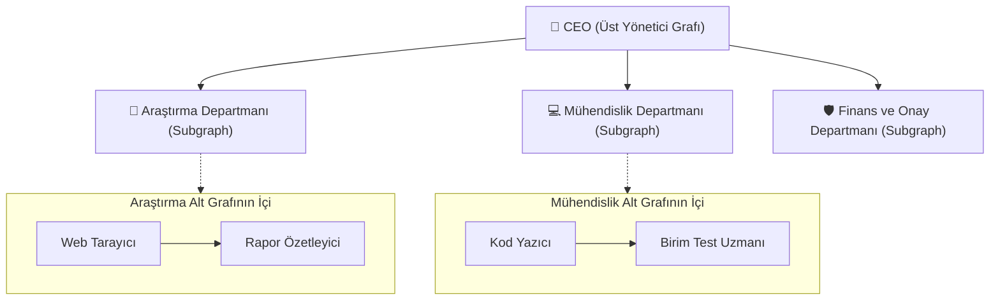

#### Çok Kritik Mimari Sır: Özel Müsvedde Defteri vs Ortak Yönetim Kurulu Klasörü!
Bir departmanın (Subgraph) kendi içindeki 20 adımlık tartışmasını, karalamalarını ve hata denemelerini CEO'nun ana panosuna (`CompanyState`) olduğu gibi dökerseniz CEO'nun kafası karışır!
LangGraph'ta her alt grafın **kendi özel State'i (Private State)** olabilir (hatta giriş ve çıkış kapılarına `input` ve `output` şemaları konabilir). Departman içeride 10 tur tartışır, ama kapıdan çıkarken CEO'nun masasına **sadece tertemiz 1 paragraflık nihai sonucunu** bırakır!

---

### Desen 4: Sürü ve Eşler Arası Bayrak Yarışı (`Swarm` / `Handoffs`)
Her zaman tepede bir müdür olmasına gerek yoktur! Çağrı merkezini düşünün: Telefonu ilk olarak **Karşılama Ajanı** açar. Sorunun teknik olduğunu anlayınca `Command(goto="Teknik_Uzman")` diyerek telefonu doğrudan uzman arkadaşına aktarır; bir sonraki mesajınızda artık doğrudan Teknik Uzman sizinle konuşur! Yöneticisiz, ultra hızlı bayrak yarışıdır (`langgraph-swarm`).

### Desen 5: Paralel Dağıt-Topla (`Map-Reduce` ve `Send` API)
Diyelim ki CEO'ya *"Türkiye'deki en büyük 8 e-ticaret rakibimizi aynı anda analiz et"* dediniz. 8 rakibi sırayla tek tek araştırmak 8 kat uzun sürer!
LangGraph'ın **`Send` API** özelliği sayesinde bir yönlendirici düğüm, çalışma anında dinamik olarak **8 adet paralel Araştırmacı kopyası** fırlatır! Sekizi de aynı saniyede farklı bir rakibi inceler, sonuçlar ortak bir `Annotated[list, operator.add]` çekmecesinde toplanır (`Reduce`) ve tek bir sentez raporuna dönüşür.

### Desen 6: Planla ve Yürüt (`Plan-and-Execute`)
Maliyet ve hız optimizasyonunun zirvesidir:
1. En başta en zeki (ve nispeten pahalı) stratejist model devreye girer ve 5 maddelik net bir iş planı çıkarır.
2. Ardından çok hızlı ve ekonomik `Flash` modelleri bu maddeleri sırayla eritir. Her adımda koca stratejist modeli yormadığınız için hem hız uçar hem maliyet düşer!

---

## Bölüm 8: Vaka Analizi — Otonom Yazılım Evi & Uygulama Stüdyosu (`06_yonetici_sirket`) Röntgeni

Şimdi tüm bu parçaların büyük final projemiz olan **[06_yonetici_sirket](file:///c:/Users/aytgn/Desktop/LangGraph_Course/06_yonetici_sirket/yonetici_masasi.py)** içinde büyük yazılım firmalarının (**Clean Architecture**, **SOLID**, **Repository Pattern**) kurumsal standartlarında nasıl birleştiğine kuşbakışı bakalım.

---

### 8.1 Felsefe Dönüşümü: Rapor Şirketinden Çalışan Yazılım İmal Eden Stüdyoya

Eğitimimizin 5. modülünde (`05_otonom_ajan_sirketi`), pazar araştırması yapan ve sanal bütçe onaylayan bir danışmanlık şirketi kurmuştuk. Ancak gerçek dünyada bir kurucu başkan yapay zekadan soyut PDF raporları değil; **elle tutulur, derhal çalışan ve müşteriye sunulabilen yazılım ürünleri** ister:
- Veritabanı ve grafik paneli olan bir **Streamlit Web Uygulaması** (Örn: Abonelik ve Finans Takipçisi),
- Swagger arayüzü ve SQLite CRUD uç noktaları olan bir **FastAPI REST Mikroservisi** (Örn: Depo Stok Yönetimi),
- Sunucu loglarını tarayan modüler bir **Python CLI Aracı** (Örn: LogAnaliz).

İşte `06_yonetici_sirket`, yapay zekayı bir sohbet botundan çıkarıp **otonom bir yazılım fabrikasına ve girişim atölyesine (Venture Builder)** dönüştürdüğümüz nihai duraktır.

---

### 8.2 Kurumsal Clean Architecture ve 6 Katmanlı Sistem Mimarisi

Büyük teknoloji şirketlerinde kodlar tek bir 2.000 satırlık spagetti dosyada yaşamaz. Değişikliklerin sistemi çökertmemesi, birim testlerin izole çalışabilmesi ve yeni departmanların kolayca eklenebilmesi için sistem **6 bağımsız Clean Architecture katmanına** ayrılmıştır:

```
06_yonetici_sirket/
├── config/             # 1. Konfigürasyon: settings.py (Kök .env, timeout, MAX_QA_SELF_HEAL_RETRIES=2)
├── data/               # 2. Veri Kalıcılığı: database.py, models.py, repositories/ (app_repository, vault_repository)
├── tools/              # 3. Dinamik Araçlar: base.py, registry.py (ToolRegistry - 9 aktif mühendislik aracı)
├── domain/             # 4. Alan Mantığı: state.py, schemas.py, workflow.py, utils.py, nodes/ (6 Departman Düğümü)
├── services/           # 5. Orkestrasyon: studio_service.py (Fabrika akışı), discovery_service.py (Konsey)
└── ui/                 # 6. Sunum Katmanı: styles.py, state.py, components/ (sidebar, matrix, explorer), views/ (tab 0..4)
```

1. **`config/`:** Kök `.env` dosyasını otomatik yükler, `output_uygulamalar/` ve `meta_bellek/` dizinlerini garantiye alır.
2. **`data/`:** `studio_projects` ve `checkpoints` tablolarını yönetir. Projelerin oluşturulması, aranması, güncellenmesi ve silinmesi (CRUD) Repository desenine emanettir.
3. **`tools/`:** Araçlar düğümlerin içine gömülmez; merkezi `ToolRegistry` üzerinde tescil edilir (AST denetimi, paketleme, kasa).
4. **`domain/`:** LangGraph'ın kalbidir. `CompanyState`, Pydantic çıktı modelleri ve tek sorumluluk ilkeli departman düğümleri burada yaşar.
5. **`services/`:** Arayüz ile LangGraph arasındaki köprüdür. Canlı streaming, fabrika sohbeti, onay, revizyon ve red mantığını yürütür.
6. **`ui/`:** Sıfır iş mantığı barındıran modüler Streamlit sunum katmanıdır.

---

### 8.3 Akıllı Durum Panosu (`CompanyState`)

Neden ajan sistemlerinde tek başına sohbet geçmişi (`messages`) yetersiz kalır? Çünkü 15 dosyalık bir projenin ortasında direktör, 80 mesajlık geçmişi okuyup *"Acaba mimar hangi kütüphaneleri seçmişti?"* diye tahmin yürütmeye kalkarsa halüsinasyon riski katlanır ve token maliyetleri uçar!

Bu yüzden `CompanyState` sözleşmemiz, gerçek bir fabrika panosu gibi durum bayrakları taşır:
- **`app_name` & `app_type`:** Uygulamanın adı ve mimari türü (Streamlit / FastAPI / CLI).
- **`prd_spec` & `core_features`:** CPO'nun hazırladığı kullanıcı akışı ve MVP fonksiyon listesi.
- **`architecture_spec` & `tech_stack`:** CTO'nun tasarladığı modüler şema ve Python kütüphaneleri sözleşmesi.
- **`code_files` & `total_loc`:** Üretilen çoklu Python dosyaları sözlüğü (`{dosya_adi: kod}`) ve gerçek satır sayısı.
- **`qa_passed` & `qa_issues`:** Deterministik AST ve çapraz import testinin sonuçları.
- **`revision_count` & `cycle_count`:** Döngü sayacı ve QA öz-iyileştirme tur sayısı.
- **`founder_feedback` & `feedback_target`:** Kurucu Başkanın verdiği revizyon talimatı ve hedef departman.
- **`is_rejected` & `rejection_reason`:** Kod reddi durumu ve gerekçesi.
- **`is_deployed` & `app_folder`:** Fiziksel kurulum bayrağı ve disk klasörü yolu.

---

### 8.4 Döngüsel LangGraph Akışı & 6 Uzman Departman

Sistemimiz düz bir boru hattı (DAG) değil; merkezi **`Studio_Director`** hakemliğinde çalışan canlı bir döngüsel grafiktir:

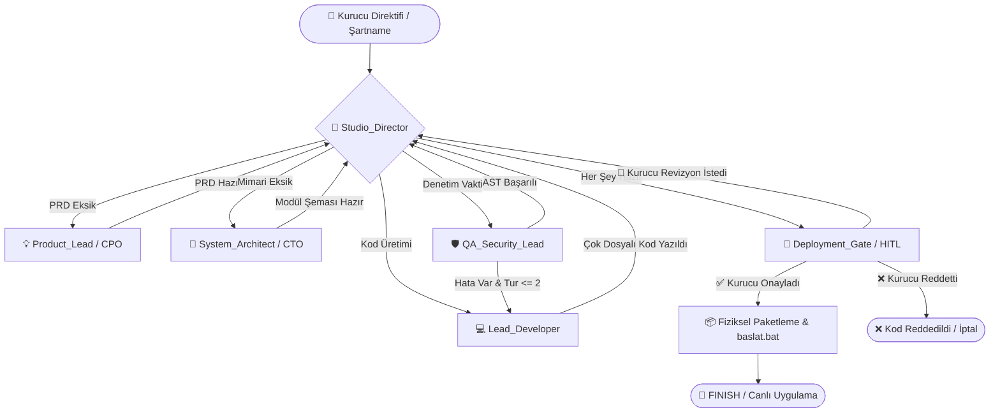

1. **👑 Studio_Director (Stüdyo Direktörü):** Grafın merkezindedir. `director_router` fonksiyonuyla durumu inceler; eksik belgeye, QA hatasına veya kurucu revizyonuna göre bir sonraki adımı belirler.
2. **💡 Product_Lead (CPO):** Ne uygulaması yapılacağını, hedef kitleyi ve MVP özelliklerini içeren kapsamlı PRD dokümanını hazırlar.
3. **📐 System_Architect (CTO):** Uygulamaya en uygun teknoloji yığınını (Streamlit, FastAPI, SQLite, CLI) ve modül sözleşmelerini tasarlar.
4. **💻 Lead_Developer (Kıdemli Mühendis):** PRD ve mimariye sadık kalarak eksiksiz, çok dosyalı temiz Python kaynak kodlarını üretir.
5. **🛡️ QA_Security_Lead (QA Lideri):** Deterministik Python AST sözdizimi ve modüller arası çapraz import denetimi yapar.
6. **🚀 Deployment_Gate (Kurucu Kapısı):** Kurucu Başkan onayı gelmeden diske tek bir dosya yazmaz; onaylanınca `baslat.bat` ile paketi inşa eder.

---

### 8.5 Deterministik Kalite & Güvenlik: AST Denetimi ve `MAX_QA_SELF_HEAL_RETRIES = 2`

Yapay zeka kod yazarken sözdizimi hatası yapabilir veya bir modülde tanımlamadığı bir fonksiyonu diğer modülden `from db import kaydet` diye import etmeye kalkabilir. Bu hataları olasılıksal bir LLM'e sormak yerine **deterministik Python AST (`ast.parse`) ve sözleşme denetçisi (`CrossModuleImportValidatorTool`)** ile sıfır hata toleransıyla test ederiz.

**Sonsuz Öz-İyileştirme Döngüsü Tuzağı:**
Eğer mühendis hata yapar ve QA bunu raporlarsa, mühendis düzeltmeye çalışır. Ancak mühendis aynı hatayı tekrarlarsa sistem sonsuz bir döngüye girip API kredilerini tüketebilir! İşte bu yüzden mimarimize **`MAX_QA_SELF_HEAL_RETRIES = 2`** emniyet kemeri ekledik: Mühendis 2 turda hatayı çözemezse direktör döngüyü keser ve durumu Kurucu Karar Kapısına eskalasyon yapar.

---

### 8.6 Kurucu Karar Kapısı (HITL Gate): Onayla, Revize Et, Kodu Reddet

LangGraph'ın `interrupt_before=["Deployment_Gate"]` mekanizması sayesinde kod diske yazılmadan önce graf durur. Yönetici Masası'nda kurucuya **3 net karar yolu** sunulur:
1. **✅ Kodu Onayla ve Diske İnşa Et:** Kodları, `requirements.txt`'yi, şartnameyi ve port çakışmasız `baslat.bat` dosyasını `output_uygulamalar/` dizinine fiziksel olarak kurar.
2. **🔄 Departmana Revizyon Gönder:** Kurucu *"Kategoriye göre filtreleme ekle"* gibi bir talimat girdiğinde, `as_node="Deployment_Gate"` güncellemesiyle graf doğrudan ilgili departmana (Mühendis, CTO veya CPO) geri yönlendirilir.
3. **❌ Kodu Reddet:**
   - **`♻️ Kodu Reddet & Sıfırdan Yazdır`:** Mevcut kodları tamamen silip mühendise sıfırdan temiz kod yazdırır.
   - **`🛑 Kodu Reddet & İnşayı İptal Et`:** Dağıtımı derhal iptal eder, uykudaki grafı uyandırıp sonlandırır ve projeyi SQLite'a kalıcı olarak **`❌ Kod Reddedildi`** statüsüyle işler.

---

### 8.7 Yazılım Fabrikası İletişim Masası & Çift Modlu Konsol

Yönetici Masası'nın en kritik yeniliklerinden biri, **kod bozulmadan fabrika ekibiyle konuşabilme yeteneğidir**. Sekme 1'de her zaman açık kalan sohbet konsolu iki modda çalışır:
- **`💬 Fabrika Ekibiyle Görüş (Soru Sor & Teknik İstişare)`:** Mevcut kodlar veya PRD değişmez. Baş Mimar (`chat_with_factory_team`) projenin durumunu, mimarisini ve kodlarını inceleyerek kurucunun sorularını yanıtlar.
- **`⚡ Otonom İmalat / Geliştirme Döngüsü Çalıştır`:** Kurucunun yeni talimatıyla fabrikayı uyandırır ve tam döngüsel kodlama sürecini çalıştırır.

---

### 8.8 İkinci Beyin (Second Brain) & Ürün-Mimari Keşif Odası

Şirketin kurumsal tecrübesi `meta_bellek/` kasasında yaşar:
- `01_sirket_vizyonu.md`: Şirket manifestosu ve temel ilkeler.
- `02_beyin_firtinasi_notlari/`: Keşif ve ürün fikirleri.
- `03_stratejik_kararlar/`: Mimari Karar Kayıtları (ADR).
- `04_operasyonel_direktifler/`: Fabrikaya aktarılan mühendislik şartnameleri.

Sekme 0'daki **Ürün & Mimari Konseyi**, Kurucu Başkanın aklındaki ham fikri alır; CPO kullanıcı akışını, CTO ise teknoloji yığınını belirler. Ardından tek bir butona tıklayarak (**`🚀 Fabrikaya Şartname Olarak Aktar`**) bu tartışmayı yeni bir SQLite projesine ve doğrulanmış mühendislik şartnamesine dönüştürür.

---

### 8.9 Gerçek SQLite CRUD Portföy Yönetimi

Tüm projeler yerel `studio_apps.db` veritabanında thread izolasyonuyla tutulur:
- **`studio_projects` Tablosu:** Her projenin `thread_id`, görünür adı, yönetici notları, etiketleri ve güncelleme tarihini saklar.
- **CREATE:** Yeni proje oluşturulduğu an veritabanına işlenir; sayfa yenilendiğinde seçim kaybolmaz.
- **READ:** Portföy sekmesinde duruma göre filtreleme (Onay Bekliyor, Reddedildi, Kurulu vb.) ve anlık metin araması yapılır.
- **UPDATE:** Proje adı, etiket ve notları doğrudan SQLite `UPDATE` sorgusuyla güncellenir.
- **DELETE:** İstenmeyen projeler checkpoints, writes ve disk çıktılarıyla birlikte kalıcı olarak silinir.
- **Time-Travel Audit:** `app.get_state_history()` ile projenin geçmiş tüm checkpoint adımları tablo halinde denetlenebilir.

---

### 8.10 Fiziksel Dağıtım ve 1-Tık Çalıştırma Paketi

Kurucu kodu onayladığında `BatchScriptGeneratorTool` devreye girer:
- **Port Güvenliği:** Yönetici Masası `8501` portunda çalışır. Çakışmayı önlemek için üretilen Streamlit web uygulamaları otomatik olarak **`8505`** portuna, FastAPI servisleri ise **`8005`** portuna yönlendirilir.
- **Windows `start ""` Çözümü:** Windows komut satırının tırnak işaretli dosya yollarını pencere başlığı sanma hatası, `cmd.exe /c start "" "baslat.bat"` sözdizimiyle çözülmüştür.
- **Tarayıcı İçi Kod Düzenleyici:** Kod Gezgini sekmesinde herhangi bir Python dosyası elle düzenlendiğinde, sistem otomatik olarak AST sözdizimi testini çalıştırır ve kurulu uygulamaya diske anında eşitler.

---

# KISIM V: GÖZLEMLENEBİLİRLİK, ÜRETİM MÜHENDİSLİĞİ VE TÜM EKOSİSTEM


## Bölüm 9: Kör Uçuşun Sonu — LangSmith, Run Tree, Maliyet/Gecikme ve Kalite Sınavları

Geleneksel bir e-ticaret sitesinde bir şeyler bozulduğunda sunucu size kıpkırmızı bir **`500 Internal Server Error`** fırlatır; hatanın hangi satırda olduğunu saniyesinde görürsünüz.

Peki 5 departmanlı bir yapay zeka şirketinde **en korkutucu hata** nedir?
Sunucunun **`200 OK` (Her şey harika!)** döndürmesi, ama içeride Araştırmacı ile Yazılımcı ajanın birbirini yanlış anlayıp 12 tur kısır döngüye girmesi, faturanıza sessizce para yazması ve en sonunda müşteriye **son derece kibar bir Türkçeyle tamamen uydurma bir cevap** vermesidir!

İşte olasılıksal sistemlerde gözlemlenebilirlik (**Observability**) bir lüks değil, uçağın kokpitindeki radar ekranıdır. Radarsız uçan çoklu ajan sistemi **kör uçuş** yapıyordur.

---

### 9.1 LangSmith Nedir ve Sıfır Kod Değişikliğiyle Nasıl Çalışır?

**LangSmith**, LangGraph'ı üreten ekibin geliştirdiği bilişsel röntgen ve kalite kontrol platformudur. En güzel yanı şudur: Mevcut graf kodunuzun içine tek bir satır bile izleme kodu yazmanıza gerek yoktur! Sadece `.env` dosyanızdaki şalteri kaldırırsınız:

```bash
LANGCHAIN_TRACING_V2="true"
LANGCHAIN_API_KEY="lsv2_pt_..."
LANGCHAIN_PROJECT="otonom-ajan-sirketi"
```

Bu şalter kalktığı anda LangGraph arka planda gerçekleşen **her düşünceyi, modele giden gizli sistem mesajlarını, seçilen araçları, harcanan milisaniyeleri ve kuruşu kuruşuna token maliyetini** asenkron olarak LangSmith paneline çizer.

*(Üstelik [01_langsmith_izleme.py](file:///c:/Users/aytgn/Desktop/LangGraph_Course/04_gozlemlenebilirlik/01_langsmith_izleme.py) ve [langsmith_atolyesi.ipynb](file:///c:/Users/aytgn/Desktop/LangGraph_Course/04_gozlemlenebilirlik/langsmith_atolyesi.ipynb) içinde kurduğumuz akıllı koruma sayesinde, bulut anahtarınız tanımlı değilse sistem 401 hatası verip çökmez; otomatik olarak **Yerel Telemetri Moduna** geçip kendi metrik tablosunu üretir!)*

---

### 9.2 Run Tree (Çalışma Ağacı) Okuma Sanatı

LangSmith'te müşterinin sorduğu tek bir sorudan nihai cevaba kadar geçen tüm yolculuğa **Trace (İz)**, bu yolculuğun içindeki her bir basamağa ise **Run (Adım / Span)** denir. Bunlar alt alta düz satırlar halinde değil, bir **Soy Ağacı (`Run Tree`)** şeklinde dizilir:

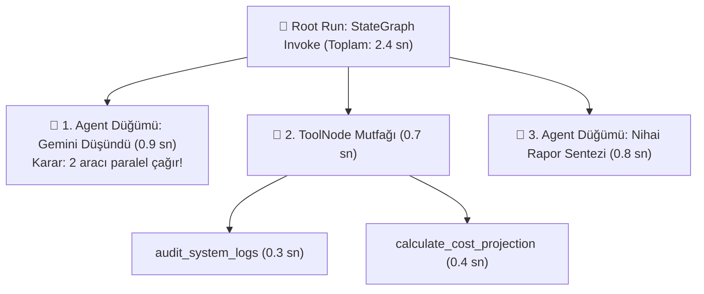

Bu ağaca 3 saniye bakan bir mimar şunu şak diye görür:
- *"Neden ajan bu soruda yanlış aracı seçti?"* -> `Adim1`'e tıklarsınız, o an modele giden tam metni ve araç kataloglarını harfi harfine okursunuz (**Bilişsel Takip / Cognitive Tracing**).
- *"Neden cevap gecikti?"* -> Şelale (`Waterfall`) çubuklarına bakarsınız; gecikmenin yapay zekadan mı yoksa yavaş çalışan bir veritabanı aracından mı kaynaklandığını anında yakalarsınız!

---

### 9.3 Kurumsal Etiketleme (`tags` & `metadata`) ve Vibe Coder Stüdyosu

Şirketinizde günde 10.000 ajan çalışması gerçekleştiğinde bunları birbirinden nasıl ayıracaksınız? Grafı çağırırken `config` çantasına taktığınız etiketlerle:
- **`tags` (`["production", "q4-audit", "infra-team"]`):** Hızlı filtreleme rozetleridir. Tek tıkla sadece canlı ortamdaki denetim sorgularını süzersiniz.
- **`metadata` (`{"cost_center": "Engineering-Ops", "user_tier": "VIP"}`):** Ay sonunda *"Mühendislik departmanının ajanları bu ay kaç dolar yaktı?"* sorusunun muhasebe fişidir!

#### Kendi Canlı Gözlem Evimiz: `BaseCallbackHandler` ve Vibe Coder Atölyeleri
Modül 4'te *"IDE kullanmıyorum, notlarımı da alabileceğim görsel bir atölye ve temiz URL'ler istiyorum"* dediğinizde deneyimlediğimiz [langsmith_atolyesi.ipynb](file:///c:/Users/aytgn/Desktop/LangGraph_Course/04_gozlemlenebilirlik/langsmith_atolyesi.ipynb) ([atolye_baslat.bat](file:///c:/Users/aytgn/Desktop/LangGraph_Course/atolye_baslat.bat)) iki harika tekniği öğretti:
1. **`BaseCallbackHandler`:** LangGraph'ın içine taktığımız canlı mikrofon! Model düşünmeye başladığı an (`on_llm_start`) ve araç tetiklendiği an (`on_tool_start`) sinyali yakalayıp ekrana canlı akıtır.
2. **Temiz Yerel Alan Adları (`lvh.me` İpucu):** Yerel web stüdyolarında çirkin `localhost:port` adresleri yerine Port 80 üzerinde `http://atolye.lvh.me` gibi okunaklı adresler kullanabilirsiniz; çünkü `lvh.me` dünyadaki tüm alt alan adlarını otomatik olarak sizin kendi bilgisayarınıza (`127.0.0.1`) yönlendiren geliştirici dostu küresel bir DNS standardıdır!

---

### 9.4 LangSmith'in Gizli Süper Gücü: Kalite Sınavları (`Datasets & Evals`)

Çoğu kişi LangSmith'i sadece bir "log ekranı" sanır. Oysa LangSmith'in asıl kurumsal gücü **Değerlendirme (`Evaluation / Evals`)** motorudur!

Diyelim ki CEO ajanınızın sistem talimatında iki kelimeyi değiştirdiniz. Bu değişikliğin ajanı daha mı zeki yaptığını yoksa başka sorularda bozduğunu nasıl bileceksiniz? Göz kararı 2 soru sorup *"İyi görünüyor"* demek rus ruletidir!

Profesyonel akış şöyle işler:
1. **Altın Veri Seti (`Dataset`):** Geçmişteki en zorlu 50 müşteri sorusunu LangSmith'te bir sınav kitapçığına kaydedersiniz.
2. **Otomatik Sınav ve `LLM-as-a-Judge` (Hakem Yapay Zeka):** Yeni ajanınızı bu 50 soruluk sınava sokarsınız. Başka bir bağımsız "Hakem Model", ajanınızın cevaplarını doğruluk, üslup ve halüsinasyon açısından 100 üzerinden puanlar!
3. **İnsan Geri Bildirimi (`Feedback`):** Arayüzünüzdeki 👍 / 👎 butonlarını `client.create_feedback(run_id=...)` ile doğrudan o yanıta bağlarsınız. Beğenilmeyen yanıtlar otomatik olarak inceleme kuyruğuna (`Annotation Queue`) düşer ve bir sonraki sınav kitapçığınızın yeni sorusu olur!

---

## Bölüm 10: Saha Dersleri — Kotalar, Anahtar Rotasyonu, 20x Hızlandırma ve Kurumsal Güvenlik

Bu bölüm, kitapların teorik sayfalarında bulamayacağınız; bizzat projeyi inşa ederken karşılaştığımız duvarlardan ve sorduğunuz keskin sorulardan çıkardığımız **gerçek dünya mühendislik dersleridir.**

---

### Ders 1: Neden Kişisel Yapay Zeka Aboneliğiniz API Kotasını Etkilemez?

Sorduğunuz en önemli sorulardan biri şuydu:
> *"Google AI (Gemini Advanced / Google One) aboneliğimi yükseltmem API kullanım limitimi artırır mı? Ve projede kota bittiğinde seninle nasıl hala konuşabiliyorum?"*

Çünkü teknoloji devlerinde **Tüketici Dünyası** ile **Geliştirici/Bulut Dünyası** tamamen ayrı iki binadır:
- **Bina 1 — Tüketici Aboneliği (`gemini.google.com`):** Aylık sabit ücret ödeyip tarayıcıdan sohbet ettiğiniz bireysel üründür. Kendi sabit kotası vardır ve kodlarınızda kullandığınız `GOOGLE_API_KEY` ile **hiçbir organik bağı yoktur.**
- **Bina 2 — Geliştirici API ve Kurumsal Bulut (`Google AI Studio` / `Vertex AI`):** Kullandığın kadar öde (`Pay-as-you-go`) veya ücretsiz geliştirici katmanıyla çalışan, yazılımların bağlandığı altyapıdır.

---

### Ders 2: Kotalar "API Anahtarı" Başına Değil, "Proje" Başınadır!

Ücretsiz katmanda kota duvarına (`429 RESOURCE_EXHAUSTED`) çarptığımızda şu zekice fikri ortaya atmıştınız: *"Birden fazla API anahtarı tanımlasak ve biri bitince diğerine geçse?"* Ve hemen ardından şu kritik soruyu sormuştunuz: *"Aynı projede farklı key'ler açmak yeterli olur mu, yoksa farklı projeler mi kurmalıyım?"*

**Altın Kural:** Google Cloud ve AI Studio'da hız ve kullanım limitleri;
- **`RPM` (Requests Per Minute):** Dakikadaki istek sayısı,
- **`TPM` (Tokens Per Minute):** Dakikadaki kelime/token hacmi,
- **`RPD` (Requests Per Day):** Günlük toplam istek hakkı,

**API anahtarı başına değil, PROJE (`Project`) başına tanımlanır!** Aynı projenin içinde 50 tane anahtar açmak, tek bir su deposuna 50 tane musluk takmaya benzer; depo bitince 50 musluk da aynı anda kurur! Gerçek bir anahtar havuzu için her anahtarın **farklı bir projeye** bağlı olması şarttır. *(Ayrıca güncel Google altyapısında yeni nesil anahtarların klasik `AIza...` formatının yanı sıra `AQ...` formatında da üretilebildiğini canlı testlerimizde bizzat doğruladık!)*

---

### Ders 3: Model Düşürmek (`Fallback`) vs Anahtar Döndürmek (`Key Rotation`)

[model_factory.py](file:///c:/Users/aytgn/Desktop/LangGraph_Course/model_factory.py) dosyamızı tasarlarken iki farklı dayanıklılık mimarisini test ettik:
1. **Model Şelalesi (Model Fallback):** Ana model kota verirse daha küçük/ucuz bir alt modele (`flash-lite`) düşmek. Maliyet dostudur ama karmaşık görevlerde ajanın zeka seviyesinde dalgalanma yaratabilir.
2. **Sabit Model + Dinamik Anahtar Havuzu (`KeyRotatingGeminiLLM`):** Sizin tercihinizle geçtiğimiz nihai mimari! Model zekasından **asla ödün vermez** (daima hedeflediğimiz güçlü model sabit kalır); bir anahtar kota veya yoğunluk sinyali verdiği milisaniyede `.env` dosyasındaki `GOOGLE_API_KEYS` havuzundan sıradaki temiz anahtara geçer! Üstelik `.env` dosyasına ileride 6., 7. veya 10. anahtarı eklediğinizde koda tek bir dokunuş bile gerekmez.

---

### Ders 4: "Analizler Neden 30 Saniye Sürdü?" — 20 Kat Hızlandırmanın Sırrı!

Hatırlıyor musunuz? Bir noktada *"Analizler biraz fazla uzun sürüyor, neden?"* diye sormuştunuz ve yaptığımız incelemeyle süreyi **~28 saniyeden ~1.5 saniyeye** indirmiştik!

Suçlu yapay zekanın yavaş düşünmesi değildi; **gizli yeniden deneme (`Retry / Exponential Backoff`) tuzağıydı!**
Standart LLM kütüphaneleri bir anahtarda kota hatası (`429`) aldığında hemen pes etmez: *"Belki düzelir"* diyerek önce 2 saniye bekler, tekrar dener, 4 saniye bekler, tekrar dener, 8 saniye bekler... 4 düğümlü bir ajan grafında bu beklemeler uç uca eklendiğinde sistem 30 saniye donmuş gibi görünür!

[model_factory.py](file:///c:/Users/aytgn/Desktop/LangGraph_Course/model_factory.py) içine koyduğumuz şu iki satırlık mühendislik dokunuşu her şeyi değiştirdi:
- **`max_retries=0`:** *"Hata alırsan saniye bile bekleme, derhal sıradaki sağlam anahtara zıpla!"*
- **`request_timeout=35.0`:** *"Sunucu yanıt vermezse sonsuza kadar asılı kalma, bağlantıyı kes ve yedek anahtara geç!"*

---

### Ders 5: Şirketler Neden 100 Ücretsiz Proje Açmak Yerine Google'a Para Öder?

Esprili ama çok derin sorunuzu hatırlayalım: *"İnsanlar neden 100 tane ücretsiz proje açıp döndürmek yerine Google'a para ödüyor? Ve Google ücretli projede veriyi eğitimde kullanmayacağının güvenini nasıl veriyor?"*

Geliştirme ve öğrenme aşamasında anahtar havuzu harika bir hayat kurtarıcıdır. Ancak gerçek şirketlerin ücretli kurumsal katmana (**Paid Tier / Google Cloud Vertex AI**) geçmesinin **4 hayati sebebi** vardır:

1. **Veri Gizliliği ve Sıfır Eğitim Garantisi (`Zero Data Retention`):** Ücretsiz geliştirici katmanlarında hizmet şartları gereği gönderdiğiniz prompt'lar kalite iyileştirme amacıyla incelenebilir. Ücretli Kurumsal / Vertex AI katmanında ise **Veri İşleme Sözleşmesi (DPA)** devreye girer: Verileriniz **asla** Google modellerini eğitmek için kullanılmaz, şifrelenir ve işlendikten sonra bellekte tutulmaz.
2. **Uluslararası Denetim ve Sertifikalar:** Bankalar ve hastaneler "söze" değil, bağımsız denetçilerin verdiği **SOC 2, ISO 27001, GDPR ve HIPAA** sertifikalarına ve milyon dolarlık tazminat maddeleri içeren **Hukuki SLA** sözleşmelerine güvenir.
3. **Eşzamanlı Kapasite:** Ücretsiz bir proje dakikada 10-15 isteğe (`RPM`) izin verirken, gerçek bir şirkette aynı saniyede 2.000 müşteri mesaj atar; kurumsal katman dakikada binlerce isteği tek anahtarla karşılar.
4. **Hizmet Şartları Güvenliği:** Ücretsiz kotaları aşmak için yüzlerce sahte proje açmak (Quota Circumvention), canlıdaki bir şirketin hesabının en kritik günde otomatik güvenlik filtreleriyle askıya alınması riskini taşır.

---

### Ders 6: Kurumsal Güvenlik ve "Cüzdan Yakmama" Kalkanları

Gerçek bir ajan sistemini canlıya alırken şu **4 güvenlik emniyet kemerini** her zaman takmalısınız:
1. **`.env` ve `.gitignore` Namustur:** Hiçbir API anahtarı veya GitHub Token'ı (`.py` dosyalarının içine) doğrudan yazılmaz! Anahtarlar sadece `.env` içinde yaşar ve `.gitignore` bu dosyayı GitHub'a yüklenmekten korur.
2. **`recursion_limit` (Sonsuz Döngü Sigortası):** Ya iki ajan birbirine sürekli iş paslayıp sonsuz döngüye girerse? LangGraph'ta varsayılan olarak **25 adımlık bir sigorta (`recursion_limit=25`)** vardır. 25 adımda iş bitmezse şalteri otomatik indirir ve sabaha kadar faturanızın yanmasını engeller! İsterseniz `config={"recursion_limit": 10}` diyerek bu sigortayı daha da sıkılaştırabilirsiniz.
3. **En Az Yetki İlkesi (`Least Privilege`):** Araştırmacı ajana veritabanı silme aracı bağlamayın! Her ajana sadece görevi için gereken minimum alet çantasını verin.
4. **Kritik Eylemlerde Zorunlu HITL:** Para çıkışı, dışarıya e-posta gönderimi ve veri silme araçlarının önünde her zaman `interrupt` freni bulundurun.

---

## Bölüm 11: Ekosistem Haritası — LangGraph ve İlgili Tüm Araçlar Rehberi

LangGraph tek başına bir ada değildir; etrafında dev bir modern araç ekosistemi vardır. Sektörde bir makale okuduğunuzda veya mimari kurduğunuzda karşınıza çıkacak **tüm araçların büyük haritası** şöyledir:

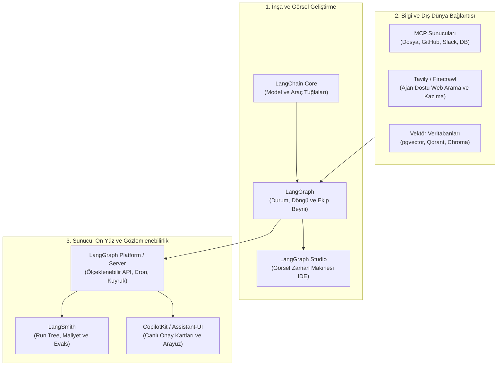

### 11.1 Büyük Üçlüyü Bir Daha Asla Karıştırmayın!
- **LangChain (`langchain-core`, `langchain-google-genai`):** **Lego tuğlalarıdır.** Farklı yapay zeka modellerini (Gemini, Claude, OpenAI), mesaj formatlarını ve `@tool` şablonlarını standartlaştırır.
- **LangGraph:** **Binanın mimari iskeleti ve trafik sistemidir.** Döngüleri, kalıcı hafızayı, insan onayını ve çoklu ajan orkestrasyonunu yönetir. *(Not: LangGraph kullanmak için eski karmaşık LangChain zincirlerini kullanmak zorunda değilsinizdir; hatta düz Python ile bile LangGraph düğümü yazabilirsiniz!)*
- **LangSmith:** **Röntgen cihazı ve kalite laboratuvarıdır.** Çalışan sistemin içini izler, maliyet ölçer ve ajanları sınava sokar.

---

### 11.2 LangGraph Studio: Kodsuz Görsel Ajan Röntgeni
Sizin gibi bir **Vibe Coder** için biçilmiş kaftandır! **LangGraph Studio**, yazdığınız grafı ekranda canlı bir akış şeması olarak açar:
- Bir soru gönderdiğinizde hangi düğümün o an parladığını canlı izlersiniz,
- Herhangi bir düğümün önüne görsel olarak "Durdurma Noktası" koyarsınız,
- Fareyle beyaz tahtadaki (`State`) bir veriyi değiştirip o adımdan itibaren grafı çatallandırarak (`Fork`) tekrar oynatırsınız!

---

### 11.3 LangGraph Platform / LangGraph Server ve `langgraph.json`
Bilgisayarınızda çalışan `sirket_motoru.py` dosyasını gerçek bir mobil uygulamaya veya web sitesine bağlamak istediğinizde karşınıza klasik sunucu dertleri çıkar. İşte **LangGraph CLI (`langgraph dev` / `langgraph up`)** ve **`langgraph.json`** yapılandırma dosyası, grafınızı tek komutla kurumsal bir API sunucusuna dönüştürür ve şu devasa dertleri kendiliğinden çözer:

1. **`Double-Texting` (Çift Mesajlaşma Krizi):** Gerçek hayatta kullanıcılar sabırsızdır! Ajan ilk soruyu araştırırken kullanıcı arkadan *"Ha bir de şuna bak!"* diye ikinci mesajı atar. Klasik sistemlerde iki işlem çarpışır ve hafıza bozulur. LangGraph Server buna 4 hazır çözüm sunar:
   - `reject` (İkinciyi beklet/reddet),
   - `enqueue` (Sıraya al, ilki bitince çalıştır),
   - `interrupt` (İlkini durdur, yeni bilgiyle devam et),
   - `rollback` (İlkini iptal edip birleştirerek baştan başla!).
2. **Arka Plan Görevleri ve `Cron` Zamanlayıcılar:** *"Her sabah 08:30'da uyan, rakiplerin fiyatlarını tara ve özet raporu bana gönder"* şeklindeki otonom zamanlanmış işleri yerleşik olarak çalıştırır.
3. **Asistans (Assistants):** Aynı graf iskeletini farklı sistem prompt'ları ve farklı modellerle versiyonlayarak yönetmenizi sağlar.

---

### 11.4 Dokümanlarda Görürseniz Şaşırmayın: `Functional API` (`@entrypoint` & `@task`)
LangGraph'ın bildiğimiz `StateGraph` (`add_node`, `add_edge`) yapısına **Graph API** denir. LangGraph ayrıca klasik Python `if / for` döngüleri yazmayı seven ama yine de Checkpointer ve `interrupt()` özelliklerinden yararlanmak isteyenler için **`@entrypoint`** ve **`@task`** etiketlerinden oluşan bir **Functional API** de sunar. Çoklu ajan ve departman mimarilerinde bizim öğrendiğimiz **`StateGraph` her zaman çok daha görsel, düzenli ve güçlüdür;** ancak dokümanlarda `@entrypoint` gördüğünüzde *"Ha, bu da aynı motorun fonksiyon tabanlı alternatif yazımıymış"* diyerek geçebilirsiniz.

---

### 11.5 Yardımcı Ekosistem Yıldızları
- **Ajan Dostu Web Araçları (`Tavily` & `Firecrawl`):** Klasik Google araması reklam ve HTML çöplüğü döndürür. **Tavily** doğrudan LLM'lerin okuması için temizlenmiş arama sonucu üretir; **Firecrawl** ise karmaşık bir web sitesini saniyede tertemiz Markdown metnine çevirir!
- **Generative UI (`CopilotKit` & `Assistant-UI`):** `interrupt()` ile ajan durduğunda, kullanıcının ekranında sadece düz metin değil; üzerinde `[Onayla: 250.000 TL]` ve `[Tutarı Düzenle]` yazan şık, etkileşimli web kartlarının belirmesini sağlayan modern ön yüz kütüphaneleridir.
- **Modern Paketleme (`uv` & `Docker`):** Python kütüphanelerini eski `pip` yerine 10-50 kat hızlı kuran **`uv`** ve tüm ajan şirketinizi tek kutuda her sunucuda çalıştıran **`Docker`**.
- **Açık Kaynak İzleme Alternatifleri (`Langfuse` & `Arize Phoenix`):** Verilerini tamamen kendi yerel sunucularında (Self-hosted) tutmak isteyen şirketlerin LangSmith'e alternatif olarak kullandığı açık kaynaklı telemetri araçlarıdır.

---

## Bölüm 12: Mezuniyet Yol Haritası — Kişisel Danışman Ajandan Gerçek Şirkete Geçiş Planı

Konuşmalarımızda geleceğe dair muazzam bir strateji kurmuştunuz:
> *"Bu eğitimi bitirdikten sonra gerçek şirket ortamı kurmaya başlayacağız. En başta kendime buradaki her şeyden haberdar olan bir Danışman Ajan (Meta-Advisor / Chief of Staff) oluşturmayı planlıyorum!"*

Bu vizyon, bir tek kişilik dev kadro (AI-Native Founder) kurmanın **en doğru** başlangıç noktasıdır. Çünkü alt işçileri sahaya sürmeden önce sizin kararlarınızı denetleyen, projelerinizi tanıyan bir "Kurmay Başkan" gerekir. İşte bugünden itibaren uygulayabileceğiniz **4 Fazlı Gerçek Şirket Planı**:

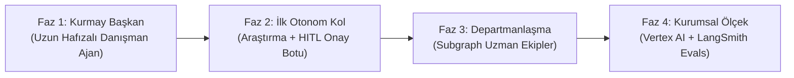

1. **Faz 1 — Kişisel Kurmay Başkan (`Chief of Staff` Ajanı):**
   - **Mimari:** Tekil ve derin düşünen bir model (`Gemini Pro` / `Argon`), `SqliteSaver` veya `PostgresSaver` ile kalıcı oturum + **`LangGraph Store`** ile uzun süreli hafıza (hedeflerinizi, tarzınızı ve geçmiş kararlarınızı asla unutmaz).
   - **Sıfır Kopyala-Yapıştır Bağlantısı:** **MCP (Model Context Protocol)** üzerinden bilgisayarınızdaki proje klasörlerine, GitHub depolarınıza ve notlarınıza doğrudan okuma yetkisi verin. Siz kopyala-yapıştır yapmadan o güncel kodlarınızı ve planlarınızı bizzat okusun!
2. **Faz 2 — İlk Operasyonel İşçi ve Cep Telefonundan Onay (`HITL`):**
   - En çok vaktinizi alan **tek bir gerçek süreci** seçin (Örn: Günlük sektör/rakip taraması veya müşteri teklif taslağı hazırlama).
   - Kritik karar noktasını `interrupt()` ile durdurup Telegram, Slack veya özel web stüdyonuzdan tek tıkla onay vereceğiniz bir köprü kurun.
3. **Faz 3 — Departmanlaşma (`Subgraphs`):**
   - İkinci ve üçüncü uzmanlık alanları doğdukça bunları ilk ajanın içine tıkıştırmayın! Ayrı birer **Subgraph** olarak tasarlayıp Kurmay Başkanınızın emrine birer departman olarak bağlayın.
4. **Faz 4 — Kurumsal Kalkan (`LangSmith Evals` + `Google Cloud Vertex AI`):**
   - Müşteri verisi ve yoğun trafik girmeye başladığında `.env` anahtar havuzundan **Vertex AI** kurumsal altyapısına geçin (Zero Data Retention güvencesi) ve her hafta başarısız örnekleri LangSmith **Dataset** sınavına ekleyerek şirketinizin zekasını kalıcı olarak yükseltin.

---

# 🧭 EKLER: Başucu Cep Rehberi

## Ek 1: Mimari Karar Ağacı ("Hangi Sorunda Hangi Aracı Seçmeliyim?")

| Karşılaştığınız İhtiyaç / Sorun | LangGraph / Ekosistem Çözümü |
| :--- | :--- |
| *"Adımlarım belli, sadece A -> B -> C sırasıyla akacak."* | Basit `StateGraph` + Normal `add_edge` (veya düz LCEL). |
| *"Ajanım dış dünyadan veri çekmeli veya işlem yapmalı."* | `@tool` (iyi docstring ile!) + `bind_tools` + `ToolNode` + `tools_condition`. |
| *"Eski mesajlar siliniyor, ajan önceki cümleyi unutuyor!"* | State içinde `Annotated[list, add_messages]` (veya `MessagesState`). |
| *"Program kapanınca veya ertesi gün konuşma kayboluyor."* | `SqliteSaver` (yerel) veya `PostgresSaver` (bulut) Checkpointer. |
| *"Farklı kullanıcıların bilgileri birbirine karışmasın!"* | Her kullanıcıya/oturuma benzersiz `configurable: {"thread_id": "..."}`. |
| *"Yeni sohbet açsam bile ajan benim kim olduğumu hatırlasın!"* | **`LangGraph Store`** (Uzun süreli oturumlar arası hafıza). |
| *"Model serbest metin yazmasın, kesin bir karar formu doldursun."* | `Pydantic BaseModel` + `llm.with_structured_output(...)`. |
| *"Para transferi / silme işleminden önce benden onay istesin."* | `interrupt_before=[...]` veya dinamik `interrupt()` + `Command(resume=...)`. |
| *"Ajan 5. adımda hata yaptı, baştan başlamadan oradan düzelteyim."* | `get_state_history()` + `update_state()` (Time-Travel & Forking). |
| *"Tek ajana 20 araç verdim, kafası karışmaya başladı."* | **Supervisor Pattern** veya **Subgraphs (Alt Graflar)** ile uzmanlara böl. |
| *"Aynı anda 10 farklı kaynağı paralel araştırıp birleştirsin."* | **`Send` API** (Dinamik Map-Reduce paralel kollar). |
| *"Kopyala-yapıştır yapmadan dosyalarıma ve uygulamalara erişsin."* | **MCP (Model Context Protocol)** + **Agentic RAG** (Vektör Veritabanı). |
| *"Ajanım neden yavaş çalışıyor veya kaç kuruş harcadı göremiyorum."* | **LangSmith** (`LANGCHAIN_TRACING_V2="true"`) veya `BaseCallbackHandler`. |
| *"Ajan sonsuz döngüye girerse faturamı patlatmasın!"* | `config={"recursion_limit": 15}` güvenlik sigortası. |

---

## Ek 2: A'dan Z'ye İnsan Dilinde LangGraph Terimler Sözlüğü

- **Agent (Ajan):** Kendi başına hangi adımları atacağına ve hangi araçları kullanacağına karar verebilen, döngüsel çalışan yapay zeka sistemi.
- **Agentic RAG:** Klasik kör belge aramasının aksine; bulduğu belgenin kalitesini denetleyen, beğenmezse soruyu değiştirip tekrar arayan akıllı LangGraph bilgi döngüsü.
- **Checkpointer:** Her süper adımda beyaz tahtanın (`State`) fotoğrafını RAM, SQLite veya PostgreSQL'e kaydeden zaman makinesi motoru.
- **`Command`:** Bir düğümün içinden aynı anda hem beyaz tahtayı güncelleyip (`update`) hem de bir sonraki gidilecek düğümü seçmesini (`goto`) veya uykudan uyanmasını (`resume`) sağlayan modern LangGraph komutu.
- **Conditional Edge (Koşullu Kenar):** Beyaz tahtanın durumuna göre akışı farklı istasyonlara yönlendiren kavşak / trafik polisi.
- **Context Bloat (Bağlam Kirliliği):** Modele gereğinden fazla geçmiş mesaj, ham veri veya araç tanımı yüklenmesi sonucu zekasının ve isabet oranının düşmesi.
- **DAG (Directed Acyclic Graph):** Geriye dönüşün ve döngünün yasak olduğu tek yönlü düz boru hattı.
- **Docstring:** Python fonksiyonunun hemen altına yazılan açıklama metni; yapay zekanın o aracı ne zaman çağıracağını anlamasını sağlayan kullanma kılavuzu.
- **Edge (Kenar):** Bir düğümden diğerine geçişi belirleyen konveyör bant.
- **Evals (Evaluations):** Ajan canlıya çıkmadan önce altın soru setleri ve Hakem Yapay Zeka (`LLM-as-a-Judge`) ile yapılan otomatik kalite sınavı.
- **Forking (Dallandırma):** Geçmişteki bir kayıt noktasına dönüp veriyi değiştirerek eski geçmişi bozmadan yeni bir paralel zaman çizgisi başlatma.
- **HITL (Human-in-the-Loop):** Kritik kararlarda ajanın dondurulup insan onayı, düzenlemesi veya yönlendirmesiyle yoluna devam etmesi.
- **`InjectedState`:** Aracın ihtiyaç duyduğu gizli/teknik verilerin (örn. kullanıcı ID'si) LLM'den saklanarak doğrudan State üzerinden fonksiyona güvenli aktarılması.
- **LangSmith:** LangGraph uygulamalarının düşünce adımlarını (`Run Tree`), gecikmelerini, maliyetlerini ve kalite sınavlarını yöneten gözlemlenebilirlik platformu.
- **LCEL (LangChain Expression Language):** `|` işaretiyle kurulan düz ve döngüsüz işlem zinciri dili.
- **MCP (Model Context Protocol):** Yapay zeka ajanlarının yerel dosyalara, veritabanlarına ve dış servislere standart tek tip fişle bağlanmasını sağlayan evrensel protokol.
- **Node (Düğüm):** Beyaz tahtayı okuyup uzmanlık işini yapan ve güncellemeleri tahtaya geri bırakan istasyon (Python fonksiyonu veya alt graf).
- **Persistence (Kalıcılık):** Ajanın durumunun sunucu kapansa dahi kaybolmayacak şekilde veritabanında yaşatılması.
- **Progressive Disclosure (Kademeli Açığa Çıkarma):** Bağlamı şişirmemek için ajana başlangıçta sadece özet başlıkları gösterip, detay kılavuzları yalnızca ihtiyaç doğduğunda yükleme prensibi (Antigravity `SKILL.md` mimarisi).
- **ReAct (Reason + Act):** Ajanın *"Düşün -> Araç Çağır -> Sonucu Gözlemle -> Yeniden Düşün"* döngüsüyle çok adımlı problemleri çözme felsefesi.
- **Reducer (Birleştirici):** Beyaz tahtadaki bir alana yeni veri geldiğinde eskisinin silinip silinmeyeceğini veya listeye nasıl ekleneceğini belirleyen kural (`add_messages`).
- **Run Tree (Çalışma Ağacı):** Tek bir kullanıcı isteğinin tetiklediği tüm düğüm, model ve araç çağrılarının hiyerarşik röntgen şeması.
- **`Send` API:** Çalışma anında sayısını önceden bilmediğiniz kadar paralel işçi düğümünü aynı anda fırlatıp sonuçlarını toplama (Map-Reduce) mekanizması.
- **State (Durum):** Graf boyunca tüm düğümlerin ortaklaşa okuduğu ve güncellediği merkezi hafıza panosu.
- **Store (LangGraph Store):** Tek bir sohbetin (`thread_id`) ötesine geçip, kullanıcı veya şirket genelinde tüm sohbetler boyunca hatırlanan uzun süreli hafıza deposu.
- **Structured Output (Yapılandırılmış Çıktı):** LLM'in serbest metin yerine `Pydantic` şemasına birebir uyan garantili veri nesnesi üretmesi.
- **Subgraph (Alt Graf):** Kendi bağımsız iç akışı ve özel hafızası olan, üst grafa tek bir departman düğümü gibi takılabilen modüler graf.
- **Super-step (Süper Adım):** LangGraph'ın Pregel motorunda bir (veya paralel birkaç) düğümün çalışıp sonuçlarının mühürlendiği tek bir zaman karesi.
- **Supervisor Pattern:** Merkezi bir yönetici ajanın uzman işçilere görev dağıtıp her adımda geri rapor aldığı ekip mimarisi.
- **`thread_id`:** Farklı kullanıcıların veya farklı projelerin hafızalarını veritabanında birbirinden tamamen izole eden oturum anahtarı.
- **`ToolNode`:** LLM'in ürettiği araç sipariş fişlerini (`tool_calls`) alıp gerçek Python fonksiyonlarını çalıştıran ve sonucu `ToolMessage` olarak tahtaya asan hazır mutfak düğümü.

---

> [!TIP]
> **Son Söz:** Artık elinizde sadece çalışan bir [LangGraph_Course](file:///c:/Users/aytgn/Desktop/LangGraph_Course/README.md) deposu değil; tek bir düğümden çok departmanlı otonom holdinglere kadar her türlü yapay zeka sistemini tasarlayabilecek eksiksiz bir **Zihinsel Harita** var. Kodlar zamanla değişir, modeller her ay yenilenir; ama bu kitapta öğrendiğiniz **Durum (State), Döngü (Cycle), Kalıcılık (Persistence), İnsan Kontrolü (HITL), Uzmanlaşmış Ekipler (Multi-Agent) ve Gözlemlenebilirlik (Observability)** ilkeleri otonom yapay zeka çağının değişmez temel taşlarıdır.
